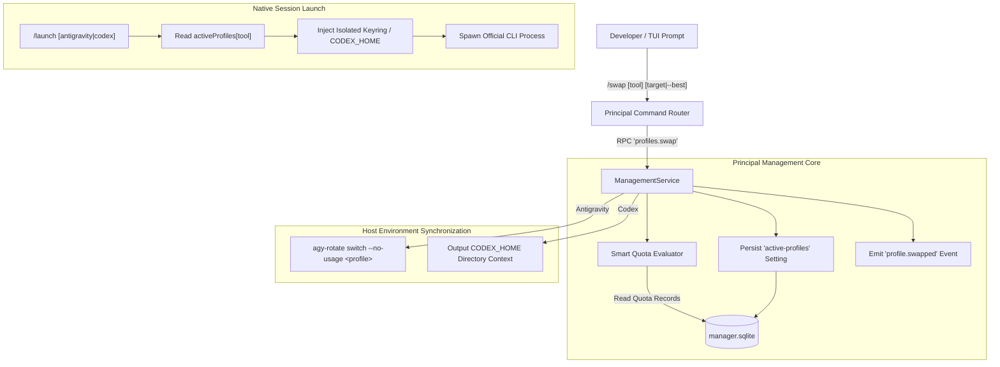
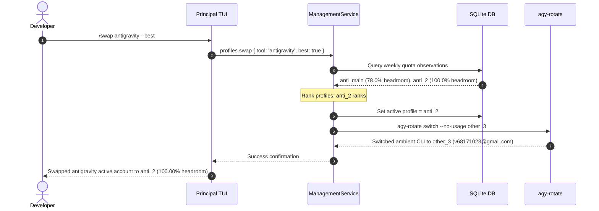

# Principal Account Hot-Swapping Guide & Architecture

## 1. Overview & Purpose
In multi-account workflows for **Antigravity** and **Codex**, developers frequently encounter rate limits, token saturation, or project-specific billing accounts. Previously, switching accounts required manual CLI reconfiguration, editing config files, or passing tedious profile flags on every invocation.

Principal provides a **zero-downtime, universal account hot-swapping system** that enables instant switching across accounts for both **Antigravity** and **Codex** (as well as Copilot and Cline):
- **Universal Hot-Swap Command**: Execute `/swap` or `/switch` in the Principal TUI prompt.
- **Smart Headroom Router (`--best`)**: Automatically select the account with the highest remaining quota headroom.
- **Ambient System Synchronization**: Automatically switches the host's external CLI state in lockstep (e.g. syncing with `agy-rotate` for Antigravity, and providing `CODEX_HOME` contexts for Codex).
- **Default Profile Resolution**: Launching native tools via `/launch` automatically defaults to the active swapped profile without needing `--profile` flags.
- **One-Key Interactive TUI**: In the `/profiles` view, press **`S`** on any highlighted account to immediately swap it into the active slot.

---

## 2. Quick-Start Cheat Sheet

| Task | Command | Shorthand | Description |
| :--- | :--- | :--- | :--- |
| **Check Active Profiles** | `/swap` or `/switch` | `/sw` | Displays active accounts and headroom percentages across providers. |
| **Swap Antigravity Account** | `/swap antigravity anti_2` | `/sw agy anti_2` | Sets `anti_2` as active Antigravity account and syncs ambient CLI. |
| **Swap Codex Account** | `/swap codex codex_main` | `/sw cdx codex_main` | Sets `codex_main` as active Codex account and updates `CODEX_HOME`. |
| **Auto-Pick Best Antigravity** | `/swap antigravity --best` | `/sw agy --best` | Evaluates weekly allowances and swaps to highest quota Antigravity account. |
| **Auto-Pick Best Codex** | `/swap codex --best` | `/sw cdx --best` | Evaluates rate limits and swaps to highest headroom Codex account. |
| **Quick Swap by Label** | `/swap anti_3` | `/sw anti_3` | Tool is inferred automatically from the unique profile name. |
| **Launch Active Antigravity** | `/launch antigravity` | `/l agy` | Starts a native CLI session with the active Antigravity profile. |
| **Launch Active Codex** | `/launch codex` | `/l cdx` | Starts a native CLI session with the active Codex profile. |
| **Launch Specific Account** | `/launch codex_4` | `/l codex_4` | Launches native CLI directly bound to `codex_4` credentials. |
| **Launch Highest Quota** | `/launch codex --best` | `/l cdx --best` | Evaluates quotas, swaps to best account, and immediately launches. |
| **Interactive TUI Swap** | Press `S` in `/profiles` | Press `S` in `/p` | Highlights any profile in Tab 1 and immediately hot-swaps to it. |
| **Open Usage / Profiles** | `/usage` / `/profiles` | `/u` / `/p` | Opens the usage telemetry view or profile manager. |

---


## 3. Architecture & Data Flow



---

## 4. Provider-Specific Mechanics

### 4.1 Antigravity Hot-Swapping & `agy-rotate` Ambient Sync
Each Antigravity profile in Principal is given a dedicated private keyring (`~/.local/state/principal/runtimes/antigravity/<profileId>/antigravity-keyring.json`). This ensures that multiple Google accounts can be signed in simultaneously without overwriting tokens or cookies.

When you hot-swap an Antigravity account:
1. **Principal Setting**: The profile ID is stored in `activeProfiles['antigravity']` inside `manager.sqlite`.
2. **Ambient CLI Sync**: Principal inspects `agy-rotate list` on your system. It matches the profile's Google account email (e.g. `v68171023@gmail.com`) to the corresponding `agy-rotate` profile name (e.g. `other_3`), and executes:
   ```bash
   agy-rotate switch --no-usage <matchedName>
   ```
3. **Result**: Both Principal's `/launch antigravity` sessions and external terminal invocations of `agy` immediately switch to the desired Google account in total lockstep!

### 4.2 Codex Hot-Swapping & `CODEX_HOME` Directory Isolation
OpenAI Codex stores authentication tokens, active threads, and model configurations inside `~/.codex` by default. Principal provides true multi-account isolation by allocating a dedicated `directory` for each profile (e.g. `~/.local/state/principal/runtimes/codex/<profileId>`).

When you hot-swap a Codex account:
1. **Principal Setting**: The profile ID is stored in `activeProfiles['codex']` in `manager.sqlite`.
2. **Active Pointer Persistence**: Principal writes the active profile's directory directly to `~/.local/state/principal/active_codex_home`.
3. **Ambient CLI Switcher**: Principal automatically maintains an ambient wrapper at `~/.local/bin/codex`. When you open any new terminal and run `codex`:
   - If `$CODEX_HOME` is not explicitly set, the wrapper reads `~/.local/state/principal/active_codex_home` and exports `CODEX_HOME` automatically.
   - It executes the official binary (`~/.codex/packages/standalone/current/bin/codex`) targeting the active profile directory with zero manual configuration.
   - Each account operates in its own isolated socket and database sandbox without daemon collisions.
4. **Manual Override Support**: If you ever want to run a specific profile ad-hoc, you can still prefix any command with `CODEX_HOME=<dir> codex`. Explicit environment variables are always respected.

---

## 5. Smart Routing with `--best`

When working extensively with LLMs, manually checking which account has quota left is tedious. The `--best` flag uses Principal's quota telemetry to pick the account with the most available quota headroom:



### Headroom Ranking Heuristics
1. **Antigravity**:
   - Queries `quota-remaining` observations for weekly windows (`gemini-weekly` and `3p-weekly`).
   - Headroom = remaining quota percentage.
2. **Codex**:
   - Queries `rate-limit-used` observations for primary/secondary windows.
   - Headroom = `100 - usedPercent`.
3. **Authentication Filter**:
   - Authenticated profiles always rank ahead of unauthenticated or errored profiles.
4. **Deterministic Tie-breaker**:
   - If two profiles have identical headroom (e.g. both at 100%), they are ordered alphabetically by label.

---

## 6. Interactive TUI Workflow

You can hot-swap accounts without typing any commands:

1. **Launch Principal**:
   Run `principal` in your terminal. By default, it opens directly into `/usage`.
2. **Go to Profiles**:
   Type `/profiles` in the command prompt (or use `/commands` $\rightarrow$ Profiles).
3. **Identify the Active Profile**:
   Notice the `[ACTIVE]` tag next to the current default account.
4. **Hot-Swap with One Key**:
   Use arrow keys `↑`/`↓` or `j`/`k` to move the cursor to your desired account.
   Press **`S`** (capital `S` / `Shift+S`).
5. **Immediate Feedback**:
   The status message confirms the swap (including ambient synchronization), and the `[ACTIVE]` badge instantly moves to your newly selected profile.

---

## 7. Launching Agents with the Swapped Account

Once an account is active, you don't need to specify which profile to use:

```bash
# Launch Antigravity using the active swapped profile
/launch antigravity

# Launch Codex using the active swapped profile
/launch codex

# Launch with custom project directory
/launch antigravity --cwd ~/my-project
```

Principal's process coordinator inspects `activeProfiles[tool]`, verifies the private keyring / directory context, and starts the native CLI agent in a protected session.

---

## 8. Frequently Asked Questions (FAQ)

### Q: Does hot-swapping terminate my currently running sessions?
**No.** Hot-swapping only updates the *default active account* for new launches and ambient CLI tools. Any running or background sessions continue executing safely in their own isolated keyrings without interruption.

### Q: What happens if I swap to an account whose quota is exhausted?
Principal allows swapping to any authenticated account. However, running `/swap` without arguments will mark accounts with low or exhausted quota so you can make an informed choice, or you can simply run `/swap <tool> --best` to guarantee picking an account with available quota.

### Q: Can I run multiple Antigravity accounts at the exact same time?
**Yes.** Because each Antigravity profile in Principal has its own isolated keyring file, multiple agent sessions using different accounts can run concurrently without race conditions.

### Q: How do I verify which account is currently active?
Just type `/swap` or `/switch` in the command bar. It prints the active account for each provider, along with current headroom percentages and the recommended next pick.
