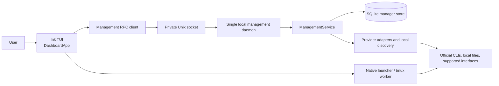

# Principal — agent handoff

Updated: 2026-10-11. This is an onboarding note for agents reviewing or improving the repository. **Read the current source and linked implementation notes before making changes; this file is a map, not a specification.**

## What Principal is

Principal is a Linux/WSL-first terminal management application for native coding-agent accounts, profiles, sessions, and usage observations. It presents a folder-like session explorer and provider-segmented `/profiles` and `/usage` views. Users continue using the providers’ official CLIs. The management TUI does not accept coding tasks. The separate MCP/CLI controlled-worker backend accepts explicit lead-agent assignments; see the current [0.2.0 handoff](CODEX_HANDOFF.md).

The core product goal is to make existing native accounts and local agent sessions easier to find, organize, launch, resume, and inspect while preserving provider authentication boundaries. The providers expose different capabilities, so the UI must distinguish verified values from cached, stale, estimated, unsupported, or unknown data. Never imply that API billing equals a consumer subscription quota, that a running process proves an account identity, or that copied conversations remain synchronized.

## Important architectural distinction

The public `principal` command opens the **native management application** under `src/management/`. Older task-graph orchestration, Docker workers, supervisor flows, and workspace-apply implementation remain in other source modules and historical documentation. They are not the current public TUI product. Do not wire those flows back into the user experience without an explicit product decision.

Management request path:



The daemon starts when Principal is opened, owns the management socket/store, reconciles local process state, and attempts supported usage refreshes every 60 seconds. It is not installed as a boot service. Native agents run as separate processes and management shutdown must not stop them.

## Repository map

- `bin/principal.mjs`: executable entry point and runtime selection.
- `src/management/daemon.ts`, `client.ts`, `service.ts`: local RPC server/client and application operations.
- `src/management/store.ts`, `model.ts`, `paths.ts`: persisted management records, types, and private XDG state paths.
- `src/management/dashboard.tsx`: public dashboard facade. UI orchestration is in `ui/DashboardApp.tsx`; provider tabs are under `ui/tabs/`; dialogs and actions under `ui/modals/` and `ui/hooks/`.
- `src/management/providers.ts`, `discovery.ts`, `observations.ts`: provider capabilities, installed-tool discovery, and usage observation collection.
- `src/management/codex.ts`, `copilot.ts`, `compatibility.ts`: supported native reads, provider-specific behavior, and conservative version checks.
- `src/management/antigravity-isolation.ts`, `browser-bridge.ts`, `browser-open.ts`, `statusline-command.ts`: experimental Linux Antigravity account isolation, limited host-browser relay, and callback-based telemetry.
- `src/management/launcher.ts`, `process.ts`, `tmux.ts`, `tmux-worker.ts`: native CLI launch and process lifecycle. Persistent terminal attachment applies to newly managed launches when available.
- `src/management/history-copy.ts`, `antigravity-history.ts`: local conversation/history import mechanisms; provider-specific and not equivalent to a provider-supported cross-account import API.
- `src/management/diagnostics.ts`, `commands.ts`, `slash.ts`, `tree.ts`: diagnostics, slash-command routing, and session-tree representation.
- `src/management/workers.ts`, `worker-runner.ts`, `worker-provider.ts`: durable, explicitly assigned worker control and native execution.
- `src/management/worker-workspace.ts`: retained pinned worktrees and alternate-index patch capture; older `worktree.ts` is a separate compatibility helper.
- `src/mcp/server.ts`, `bin/principal-mcp.mjs`: Model Context Protocol (MCP) server for Lead Agent swarm delegation (`principal-mcp`).
- `src/management/web-server.ts`, `src/management/web/dashboard.html`: browser-based management UI (`principal web`).
- `scripts/workflow.mjs`: supported build/check/test workflow. Node.js >=24 is required; the workflow records and reuses the runtime.
- `tests/`: automated unit and synthetic integration checks. Live smoke scripts may sign in, start provider sessions, or consume quota; inspect their behavior before running.

## Local development

From the repository root:

```sh
npm ci
node scripts/workflow.mjs build
node scripts/workflow.mjs check
node scripts/workflow.mjs test
```

`npm run build`, `npm run check`, and `npm test` are aliases. `npm run test:login`, `test:live`, and `test:antigravity` are live/provider-oriented workflows and require separate scrutiny; do not run them casually. A synthetic test passing does not establish compatibility with a real account or provider service.

Run the TUI with `node bin/principal.mjs` or the installed `principal` executable. Main views are `/sessions`, `/profiles`, `/usage`, and `/doctor` (`/diagnostics`). In provider tabs, Tab/Shift+Tab changes provider. Common profile actions include add, use existing login, sign in, launch, rename, and remove.

## Data and security boundaries

By default, management state lives beneath `~/.local/state/principal/management/`: `manager.sqlite`, managed profile configuration directories, a lock file, and a private local socket (runtime socket may be under `XDG_RUNTIME_DIR`). Paths honor XDG overrides. Directory/socket permissions are restricted to the current OS user. Treat the database and profile directories as sensitive; never paste credential contents, tokens, OAuth URLs, or account identifiers into issues, logs, docs, or test fixtures.

Discovery can register references to native profiles, but directory presence alone is not proof of authentication. Native credentials belong to provider-managed configuration/keychain mechanisms. Do not read/decrypt private credential stores or copy credentials between profiles. Use only supported provider interfaces and explicit user-controlled login. A 401 is an authentication rejection; a network failure is not proof of logout. Keep raw provider error bodies and secrets out of persisted observations and UI output.

Profile deletion is intended to hide Principal’s registration, not erase native provider credentials or history. History copies are explicit local snapshots, not synchronization. Never stop an unrelated/external process to make an operation succeed. Principal cannot attach to arbitrary pre-existing terminal processes; exact tmux attachment is supported only for owned persistent launches.

## Current provider and feature boundaries

- **Codex:** native account/usage/history reads are gated by detected interface compatibility. Authentication refresh remains native and user-controlled. Local JWT expiry is only token metadata, not proof that the service will authorize requests. A rejected auth state should be surfaced with a sign-in path, while network failure preserves the last-known state and labels the observation.
- **Copilot:** uses native account selection and supported account/quota interfaces. Preserve provider-reported units and reset data; do not invent conversions to “AI credits.”
- **Antigravity:** usage comes from configured native statusline callbacks; refresh does not call a private usage endpoint or start inference. The TUI intentionally shows Gemini weekly and Claude weekly bars, not assumed five-hour limits. Linux isolated profiles use separate HOME/keyring/D-Bus state and a restricted host-browser relay. Real independent-account OAuth/refresh remains unverified. History copy is experimental; schema checks do not prove unknown payloads or cross-account continuation are safe.
- **Claude:** native usage requires explicitly configured supported statusline observation. Missing callback data means unavailable, not zero.
- **Cline:** free software does not mean unlimited model/provider usage. Display “Free · no software subscription quota” separately; do not claim a default 100% quota.

These are capability boundaries, not a promise that every installed CLI version is currently supported. Version gates live in source and provider docs; preserve conservative behavior when the native interface changes.

## Recent implementation notes

See [review decisions and implementation evidence](IMPROVEMENTS_IMPLEMENTED.md), [native-management guide](NATIVE_MANAGEMENT.md), [Antigravity profile isolation](ANTIGRAVITY_PROFILES.md), and [Antigravity history limits](ANTIGRAVITY_HISTORY.md). The 2026-10-11 improvement review records:

- wrapped Codex 401 classification and safe auth-state recovery;
- bounded `/doctor` diagnostics and conservative version compatibility;
- modularization of the formerly monolithic management dashboard;
- SQLite expression indexes and bounded retention without a schema rewrite;
- persistent tmux attach for newly launched managed sessions;
- a limited host browser relay for approved Antigravity login hosts;
- multi-account swarm delegation via Model Context Protocol (`principal-mcp`) and CLI (`principal swarm`).

## Controlled-worker protocol for lead agents (0.2.0)

The lead selects exact profiles/models and owns instructions, follow-ups, retries, review, and integration. Principal supplies durable execution and reports observations without automatic account selection.

- Inspect `principal_list_profiles`, then call `principal_start_worker` with `request_id`, `profile_id`, `cwd`, and `task`.
- Inspect bounded events/artifacts through `principal_get_worker` and `principal_read_worker_artifact`; send follow-ups with `principal_send_worker_message`.
- Codex supports live steering with the expected native turn ID. Antigravity and Copilot queue messages between turns; live steering is unsupported. Copilot uses SDK protocol 3 with the current native login and cannot isolate independent accounts.
- Stop and resume individual workers explicitly. Retained worktrees are removed only by `principal_release_worker` after final capture.
- Workers survive MCP disconnection and management restart. Exclusive profile leases prevent competing launches. Unknown process ownership retains the reservation.
- Existing swarm tools are explicit batch wrappers: each task requires a different profile; automatic routing and blocking deployment are rejected.
- Read the [lead guide](AGENT_SWARM_ORCHESTRATOR_GUIDE.md) and [architecture](AGENT_SWARM_ARCHITECTURE.md) for migration and operating limits.

The cited tests are synthetic/local. Real Codex reauthentication, independent Antigravity accounts and token refresh, provider-specific persistent terminal behavior, and Antigravity cross-account history continuation still need user-controlled validation. The 60-second refresh interval only refreshes providers with supported local/native observations; exponential backoff can make a failed profile refresh less often. It cannot manufacture telemetry that a provider does not expose.

## How to improve the project safely

1. Start with `README.md`, this handoff, `IMPROVEMENTS_IMPLEMENTED.md`, and the provider-specific docs, then trace the relevant behavior into source. For behavior questions, source is authoritative.
2. Reproduce the problem using synthetic fixtures or a disposable profile where possible. Avoid starting live inference, consuming quota, signing out, changing credentials, deleting provider data, or stopping a user-owned process.
3. Preserve epistemic status in models and UI: identify source, observation time, freshness, confidence, and whether a value is official, local, estimated, or unavailable.
4. Keep provider-specific behavior provider-specific. Add a capability only when the native interface is verified; do not create a universal abstraction that promises unsupported parity.
5. Prefer small changes and preserve existing user data. The repository may be an all-untracked workspace; inspect `git status` before edits, and do not run `git clean`, reset, or broad formatting that could discard someone’s work.
6. Report what changed, what was actually checked, and what remains unverified. Do not imply commit, push, installation, or deployment unless it happened.

## Further reading

- [Product and usage guide](../README.md)
- [Current native-management behavior](NATIVE_MANAGEMENT.md)
- [Recent improvements and verification limits](IMPROVEMENTS_IMPLEMENTED.md)
- [Historical roadmap and reviewed proposals](IMPROVEMENTS_ROADMAP.md)
- [Antigravity profiles](ANTIGRAVITY_PROFILES.md) and [history copying](ANTIGRAVITY_HISTORY.md)
- [Current implementation status](STATUS.md)

