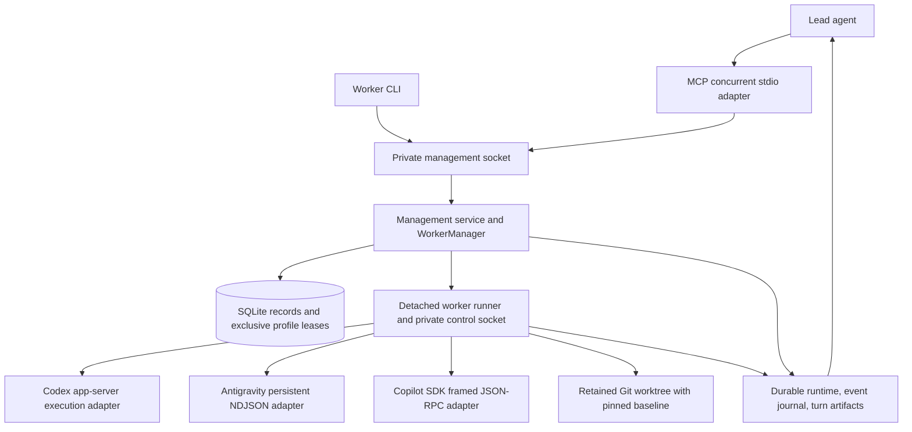

# Controlled-worker architecture (0.2.0)

The lead owns task decomposition, exact profile/model selection, follow-ups, retry decisions, validation, and integration. Principal owns execution mechanics and reports evidence without routing work.

## Ownership and persistence

`workers.ts` coordinates durable records, idempotent request receipts, profile reservations, capability inspection, and batch grouping. `service.ts` dispatches worker RPCs and shares the reservation guard with native launch preparation and profile removal. Reservation checking and invocation insertion occur in the same SQLite transaction, so native launch cannot race an MCP reservation. New record kinds are additive to the existing schema; no provider history or credential migration is performed.

Each worker has a private directory under the management state's `workers/<uuid>/`, with `spec.json`, `runtime.json`, `events.jsonl`, `runner.log`, and `artifacts/`. Specifications contain the assigned prompt and native profile metadata, but no copied credential material or persisted environment. All state is local and owner-only. Runtime sockets use short UUID paths under the existing private runtime directory.

The detached runner owns stdin/stdout protocol pipes and provider lifecycle. It writes fsynced journal events and atomic runtime snapshots. The daemon can reconnect after restart; MCP connection lifetime is independent of execution. Request receipts are persisted before acknowledging mutations. An ambiguous native delivery is not automatically replayed.

A warm runner retains its profile reservation across turns. Shutdown retains the reservation until process exit is verified. Reconciliation checks PID, boot ID, and start time. Missing runners with surviving owned processes require explicit cancellation; unknown launch ownership remains reserved. Linux/Python pidfds bind termination to checked process identities instead of reusable bare PIDs.

## Native execution

`worker-provider.ts` is intentionally separate from the read-only Codex observer. Codex uses app-server initialize, thread start/resume, turn start/steer/interrupt, and streamed completion events. Native protocol acceptance validates actual model/effort requests; no model substitution is performed. Generated/native IDs are validated and retained per profile.

Antigravity reuses the existing private HOME/D-Bus/keyring launch helper where required. Native PID reporting is retained. Persistent stream-json input/output receives a new user message only after the preceding result; mid-turn control messages are unsupported. Print-mode internal timeout is disabled so the runner's explicit deadline is authoritative.

Copilot uses SDK protocol 3 over Content-Length-framed JSON-RPC, checked by a startup ping. Session create/resume binds an exact session ID and retained working directory; send queues one prompt, and abort interrupts it. Only matching-session events are collected. `session.idle` completes a turn and `session.error` fails it; assistant message/turn events alone do not signal completion. Native tool permissions use the existing unattended worker policy; user-input requests fail explicitly. Follow-ups are queued, with no live steering. Copilot uses the current native configuration/login only; alternate or isolated configurations are rejected, and profile aliases share busy checks.

Only terminal provider success completes a turn. Process exit, structured failure, timeout, cancellation, capture failure, and interrupted recovery remain separate outcomes. Raw provider error bodies and authentication payloads are classified without persistence. User-visible agent output is redacted and paginated; private reasoning streams are not collected.

Runner heartbeat and provider progress are separate. Default startup/turn/inactivity thresholds are 60/300/120 seconds respectively; inactivity only warns. Failure stops the worker and pauses queued messages, preventing a failing account from draining an unattended task queue. Resume is explicit and does not silently replay pending turns.

## Retained code and batch semantics

`worker-workspace.ts` provisions a worktree under Git's actual common directory, preserving subdirectory working roots and exposing source dirty state. Its pinned commit is the diff baseline even if the worker makes commits. Alternate-index capture includes untracked/binary files and leaves staging untouched. Completed turn artifacts remain available; release saves a separate final snapshot before deleting the exact owned branch/worktree pair.

Swarm endpoints are durable grouping wrappers around explicit individual assignments. They do not select profiles or retry work. Duplicate profile assignments and implicit queues are rejected; setup failures remain per-task facts and existing workers remain controllable. Initial-turn status remains separate from later follow-up turns.

The stdio server processes independent requests concurrently. Request cancellation aborts its management wait, while explicit worker cancellation controls provider execution. Bounded NDJSON input, bounded event pages, and base64 artifact chunks avoid giant transcript/diff responses. This implementation uses ordinary MCP tools and does not require experimental MCP task extensions.

See the [lead guide](AGENT_SWARM_ORCHESTRATOR_GUIDE.md) for inputs, lifecycle rules, migration, CLI commands, and verification limits.
