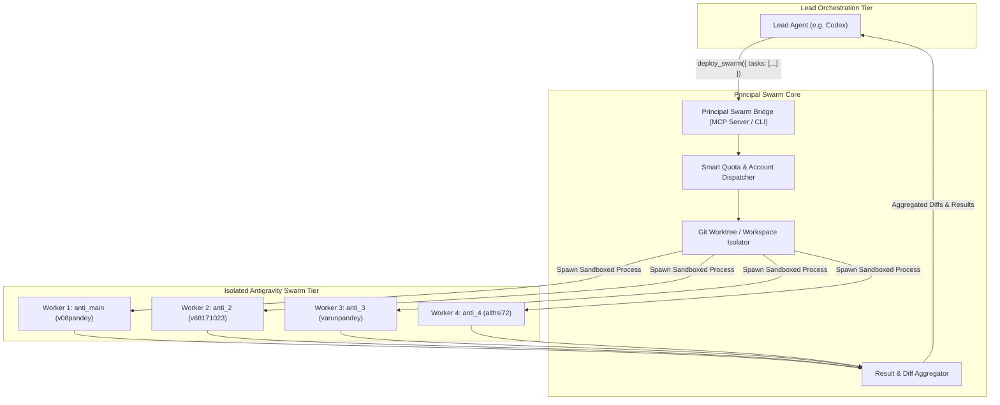

# Principal Swarm Orchestrator: Multi-Agent Delegation Architecture

## 1. Vision & Overview
The goal is to transform Principal into a **universal multi-agent swarm deployment engine**. 

Any primary or "Lead Agent" (e.g. **Codex**, **Claude Code**, or **Antigravity**) can act as the central coordinator and delegate parallel subtasks to a swarm of worker agents running across Principal's isolated provider profiles (such as 4 parallel Antigravity accounts, isolated Codex workers, or Copilot).



---

## 2. Core Responsibilities & Division of Labor

| Component | Responsibility |
| :--- | :--- |
| **Lead Agent** (e.g. Codex) | • Breaks complex epics into orthogonal, concurrent subtasks.<br>• Synthesizes and reviews worker diffs/reports.<br>• Makes final integration decisions and merges code. |
| **Principal Swarm Engine** | • **Account Allocation**: Automatically maps subtasks to accounts with highest weekly quota headroom.<br>• **Runtime Isolation**: Injects virtualized XDG roots and private keyrings for each worker.<br>• **Workspace Safety**: Provisions isolated Git worktrees so workers never collide on files.<br>• **Lifecycle & Telemetry**: Monitors worker processes, handles timeouts, and tracks rate limits. |
| **Worker Agents** (e.g. Antigravity) | • Execute specialized prompts (e.g. test writing, refactoring, benchmark exploration, security analysis).<br>• Produce structured responses, file modifications, or diagnostics. |

---

## 3. Communication Protocols: How the Lead Agent Interacts with Principal

To allow any agent (Codex, Claude, Cursor, scripts) to control Principal without modifying their native core, Principal can expose two clean interfaces:

### Option A: Model Context Protocol (MCP) Server (Recommended)
Codex and Claude natively support external MCP servers. Principal registers an MCP server (e.g. `principal-mcp`) providing tools:

1. **`principal_deploy_swarm`**:
   ```json
   {
     "name": "principal_deploy_swarm",
     "description": "Deploy a swarm of isolated worker agents across available Antigravity or Codex accounts.",
     "parameters": {
       "type": "object",
       "properties": {
         "provider": { "type": "string", "enum": ["antigravity", "codex", "auto"], "default": "antigravity" },
         "tasks": {
           "type": "array",
           "items": {
             "type": "object",
             "properties": {
               "id": { "type": "string" },
               "task": { "type": "string", "description": "Specific instruction for the worker agent" },
               "cwd": { "type": "string", "description": "Working directory or repository path" },
               "isolate_workspace": { "type": "boolean", "default": true, "description": "Create isolated Git worktree" },
               "model": { "type": "string", "description": "Optional model override" }
             },
             "required": ["id", "task"]
           }
         },
         "wait_for_completion": { "type": "boolean", "default": true }
       },
       "required": ["tasks"]
     }
   }
   ```

2. **`principal_get_swarm_status`**:
   Poll or stream the progress, stdout/stderr, and live quota usage of dispatched worker agents.

3. **`principal_collect_results`**:
   Fetch git patches, artifacts, and summary logs from completed workers.

4. **`principal_cancel_swarm`**:
   Gracefully terminate worker agents.

### Option B: Headless Non-Interactive CLI
For environments that execute shell commands:
```bash
principal swarm run \
  --provider antigravity \
  --tasks tasks.json \
  --parallel 4 \
  --worktrees \
  --output results.json
```

---

## 4. Worktree & Workspace Safety Subsystem

If 4 worker agents edit code in the same directory concurrently, they will corrupt Git indexes and overwrite each other's changes. 

Principal prevents this via **Dynamic Git Worktrees**:
```
~/my-project/                           <-- Lead Agent (Codex) Working Tree
.git/principal-worktrees/
  ├── swarm-task-1/                     <-- Worker 1 (anti_main) on branch swarm/task-1
  ├── swarm-task-2/                     <-- Worker 2 (anti_2) on branch swarm/task-2
  ├── swarm-task-3/                     <-- Worker 3 (anti_3) on branch swarm/task-3
  └── swarm-task-4/                     <-- Worker 4 (anti_4) on branch swarm/task-4
```

1. **Auto-Branching**: Principal creates ephemeral worktree branches `git worktree add -b swarm/<id> <path> HEAD`.
2. **Execution**: Worker agents execute within their assigned worktrees.
3. **Diff Capture**: Upon task completion, Principal generates a unified diff (`git diff HEAD`) from each worktree.
4. **Cleanup & Handback**: Principal tears down the worktree and returns the patches to the Lead Agent to apply or discard.

---

## 5. Smart Account Mapping & Quota Balancing

When a swarm of 4 tasks is requested:
1. Principal inspects `manager.sqlite` for all authenticated profiles under the target provider.
2. For Antigravity, it ranks `anti_main`, `anti_2`, `anti_3`, and `anti_4` by weekly quota headroom (`profileHeadroom`).
3. It assigns Task 1 to the highest headroom account, Task 2 to the second highest, etc.
4. Each worker is spawned with its private keyring password retrieved from the Secret Service and launched using `isolatedAntigravityLaunch`.

---

## 6. Real-World Use Case Example

**Scenario**: You are using Codex to refactor an entire TypeScript project.
1. Codex realizes the project has 4 large modules: `auth`, `billing`, `api-routes`, and `database`.
2. Codex calls:
   ```json
   principal_deploy_swarm({
     "provider": "antigravity",
     "tasks": [
       { "id": "auth-audit", "task": "Audit auth.ts for token expiration bugs and write unit tests." },
       { "id": "billing-refactor", "task": "Convert stripe webhook handlers in billing.ts to v2 API." },
       { "id": "api-docs", "task": "Generate OpenAPI specs from routes in api-routes.ts." },
       { "id": "db-indexes", "task": "Analyze slow queries in database.ts and add necessary SQLite indexes." }
     ]
   })
   ```
3. Principal deploys:
   - Worker 1 on `anti_main` (v08pandey@gmail.com) in `worktree/auth-audit`.
   - Worker 2 on `anti_2` (v68171023@gmail.com) in `worktree/billing-refactor`.
   - Worker 3 on `anti_3` (varunpandeyofficial@gmail.com) in `worktree/api-docs`.
   - Worker 4 on `anti_4` (althsi72@gmail.com) in `worktree/db-indexes`.
4. All 4 workers work simultaneously at full speed on separate Google quota allowances.
5. In 60 seconds, Principal gathers the 4 git diffs and reports back to Codex.
6. Codex reviews the diffs, applies them to your main workspace, and presents the completed project.
