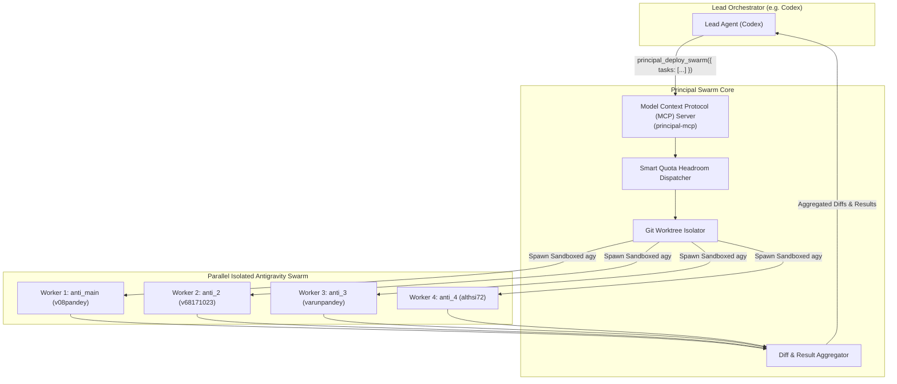

# Principal Swarm Orchestrator & Multi-Account Agent Delegation Guide

## 1. Overview
The **Principal Swarm Orchestrator** transforms Principal into a universal subagent delegation backend. 

Any **Lead Agent** (e.g. **Codex**, **Claude Code**, or **Cursor**) can act as the main orchestrator, dividing complex projects into parallel tasks and delegating them to a swarm of worker agents running across your isolated accounts (e.g. **4 parallel Antigravity accounts**, multiple Codex accounts, or Copilot).



---

## 2. Core Capabilities

1. **True Parallel Account Execution**:
   - Each worker runs in an independent sandbox (`~/.local/state/principal/management/profiles/<id>/`) with private GNOME Keyring instances and separated storage.
   - All 4 Antigravity accounts (`anti_main`, `anti_2`, `anti_3`, `anti_4`) run simultaneously with zero lock contention or keyring collisions.

2. **Smart Quota Headroom Dispatching**:
   - Tasks are automatically assigned to accounts with the highest remaining weekly quota (`profileHeadroom`).
   - If more tasks are submitted than available accounts, Principal automatically pools and queues tasks across accounts.

3. **Dynamic Git Worktree Isolation**:
   - Workers never edit files in the same working tree at the same time.
   - Each worker is provisioned an ephemeral Git worktree under `.git/principal-worktrees/swarm-<task-id>`.
   - When a worker finishes, Principal captures a unified git patch (`git add -N . && git diff HEAD`) and cleans up the worktree and branch.

4. **Standards-Compliant MCP Server**:
   - JSON-RPC 2.0 stdio server (`principal-mcp` or `principal serve-mcp`).
   - Connects natively with Codex, Claude Code, Cursor, and any MCP-compatible tool.

---

## 3. Connecting Codex as the Lead Orchestrator

Codex supports external MCP servers out-of-the-box via its configuration file `~/.codex/config.toml` (or per-project `.codex/config.toml`).

### Configuration in `~/.codex/config.toml`

Add the Principal Swarm MCP server to your Codex configuration:

```toml
[mcp_servers.principal_swarm]
command = "node"
args = ["/home/varun/principal/bin/principal-mcp.mjs"]
```

Or using the installed binary:

```toml
[mcp_servers.principal_swarm]
command = "principal-mcp"
```

Once added, Codex has access to 4 new native tools:
- `principal_deploy_swarm`
- `principal_get_swarm_status`
- `principal_cancel_swarm`
- `principal_list_profiles`

---

## 4. MCP Tool Specifications

### `principal_deploy_swarm`
Dispatches a parallel swarm of worker agents across available accounts.

**Parameters**:
```json
{
  "provider": "antigravity", // "antigravity" | "codex" | "auto"
  "tasks": [
    {
      "id": "task-auth",
      "task": "Audit src/auth.ts and write comprehensive unit tests in tests/auth.test.ts",
      "cwd": "/path/to/repo",
      "isolate_workspace": true,
      "model": "gemini-2.5-pro"
    },
    {
      "id": "task-db",
      "task": "Optimize queries in src/db.ts and add missing SQLite indexes",
      "cwd": "/path/to/repo",
      "isolate_workspace": true
    }
  ],
  "wait_for_completion": true,
  "timeout_seconds": 300,
  "max_parallel": 4
}
```

**Returned Result**:
```json
{
  "swarmId": "8f9b31d0-1a2c-4e89-b541-6d73f4e91204",
  "provider": "antigravity",
  "status": "completed",
  "startedAt": "2026-10-16T11:30:00.000Z",
  "completedAt": "2026-10-16T11:31:15.000Z",
  "workers": [
    {
      "id": "task-auth",
      "profileId": "d3b962e4-e6f5-42db-8c91-23302b7fbf24",
      "profileLabel": "anti_main",
      "tool": "antigravity",
      "account": "v08pandey@gmail.com",
      "status": "completed",
      "exitCode": 0,
      "durationMs": 42100,
      "output": "Successfully audited auth.ts and wrote tests/auth.test.ts.",
      "gitDiff": "diff --git a/tests/auth.test.ts b/tests/auth.test.ts\n...",
      "modifiedFiles": ["tests/auth.test.ts"]
    },
    {
      "id": "task-db",
      "profileId": "4038b46f-cacd-4fe1-953d-3141ebf5e24d",
      "profileLabel": "anti_2",
      "tool": "antigravity",
      "account": "v68171023@gmail.com",
      "status": "completed",
      "exitCode": 0,
      "durationMs": 38900,
      "output": "Added indexes on sessions(profileId) and entries(projectId).",
      "gitDiff": "diff --git a/src/db.ts b/src/db.ts\n...",
      "modifiedFiles": ["src/db.ts"]
    }
  ],
  "summary": "Swarm 8f9b31d0-1a2c-4e89-b541-6d73f4e91204 finished with status 'completed': 2/2 tasks completed successfully."
}
```

### `principal_list_profiles`
Lists all enrolled profiles with live headroom and busy status so the Lead Agent can check available bandwidth.

---

## 5. CLI Usage

Principal provides full CLI support for headless scripts or terminal invocations:

### 1. View Available Swarm Profiles & Headroom
```bash
principal swarm profiles
```
Output:
```
Available Swarm Profiles:
------------------------------------------------------------
• anti_main      [antigravity] [AVAILABLE]  Headroom: 100.0%   v08pandey@gmail.com (host)
• anti_2         [antigravity] [AVAILABLE]  Headroom: 100.0%   v68171023@gmail.com (isolated)
• anti_3         [antigravity] [AVAILABLE]  Headroom: 100.0%   varunpandeyofficial@gmail.com (isolated)
• anti_4         [antigravity] [AVAILABLE]  Headroom: 100.0%   althsi72@gmail.com (isolated)
• codex_main     [codex]       [AVAILABLE]  Headroom: unknown  v08pandey@gmail.com (host)
• codex_1        [codex]       [AVAILABLE]  Headroom: unknown  v68171023@gmail.com (isolated)
• codex_2        [codex]       [AVAILABLE]  Headroom: unknown  varunpandeyofficial@gmail.com (isolated)
• codex_4        [codex]       [AVAILABLE]  Headroom: unknown  althsi72@gmail.com (isolated)
------------------------------------------------------------
```

### 2. Run Parallel Tasks via CLI
```bash
principal swarm run \
  --provider antigravity \
  --task "Write unit tests for authentication" \
  --task "Optimize database queries in database.ts" \
  --task "Update OpenAPI docs in routes.ts" \
  --task "Benchmark JSON serialization latency"
```

### 3. Run from a JSON Task File
```bash
principal swarm run --provider antigravity --tasks my-tasks.json --json
```

### 4. Start the MCP Server
```bash
principal serve-mcp
# or
principal-mcp
```
