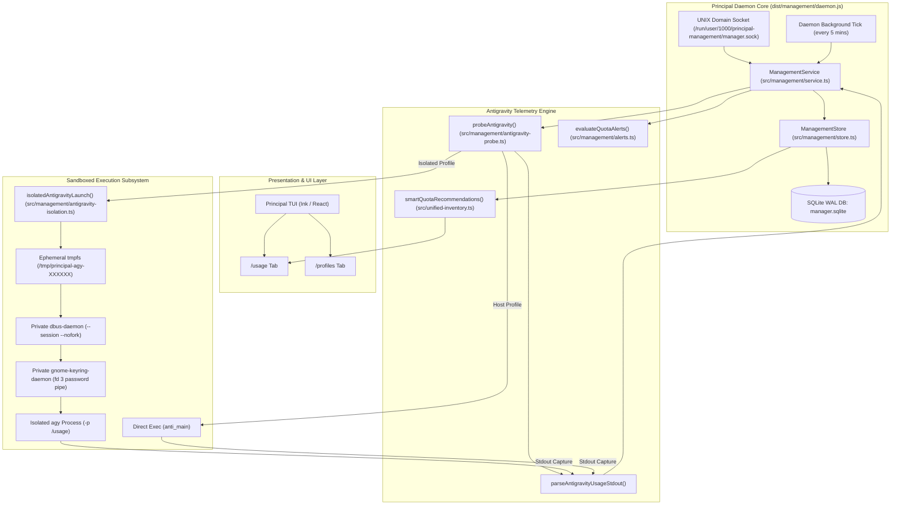
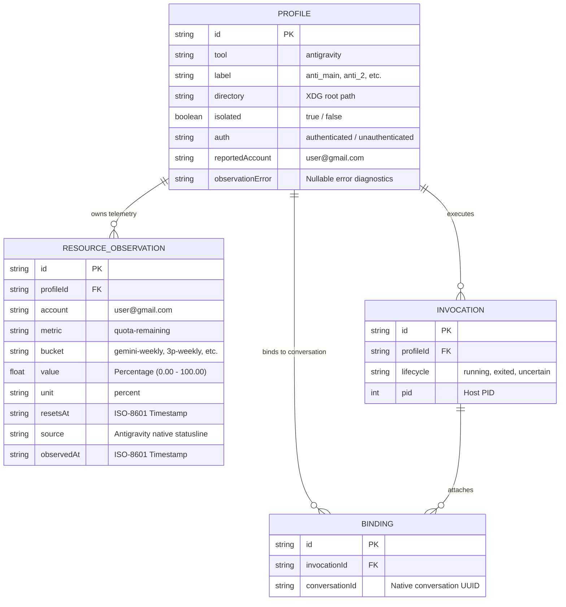
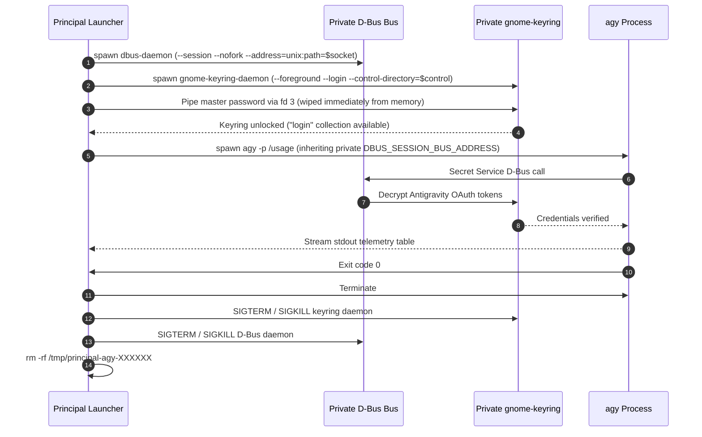
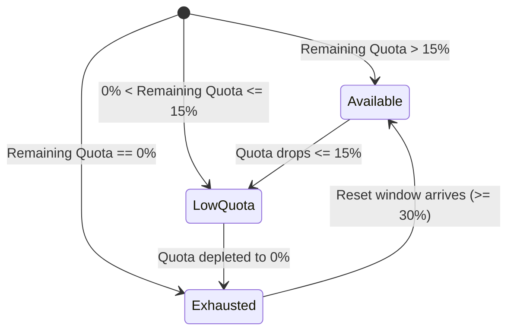

# Principal Multi-Account Architecture for Antigravity

This document details the complete end-to-end architecture of **Principal** for managing, isolating, extracting, persisting, and intelligently routing multi-account **Antigravity** usage telemetry.

---

## 1. System Context & Engineering Challenges

Official Google Antigravity (`agy`) is designed strictly as a single-account interactive CLI companion. Under standard Linux desktop environments, managing multiple Antigravity identities (`v08pandey@gmail.com`, `v68171023@gmail.com`, `varunpandeyofficial@gmail.com`, `althsi72@gmail.com`) introduces major architectural blockers:

1. **No Polling REST Endpoint**: Unlike OpenAI Codex (which provides an internal `app-server` JSON-RPC socket) or GitHub Copilot (which exposes `account.getQuota`), Antigravity has **no programmatic daemon or API** for querying remaining allowances.
2. **Push-Only Statusline Legacy**: Telemetry originally arrived solely via interactive terminal callbacks while the user was actively executing turns. An inactive account would report stale data indefinitely.
3. **Secret Service Collision**: Antigravity stores OAuth tokens in the Linux Secret Service (`gnome-keyring` via D-Bus session bus). If two accounts launch on the host session bus, they overwrite or lock each other's credentials.
4. **Interactive GUI Traps**: Invoking keyring unlock naively triggers Polkit or GTK desktop password prompts, breaking automated headless observation.

Principal resolves all of these constraints through a layered architecture featuring **XDG directory virtualization**, **ephemeral private D-Bus/Keyring bridges**, **headless `/usage` stream interception**, **SQLite WAL persistence**, and a **heuristic Smart Router**.

---

## 2. Architectural Blueprint



---

## 3. Data Model & Database Architecture

Principal records all profile registrations, telemetry buckets, and historical events in a durable SQLite database configured with **Write-Ahead Logging (WAL)** at `~/.local/state/principal/management/manager.sqlite`.

### Entity-Relationship Diagram



### Database Implementation
**File**: [`src/management/store.ts`](file:///home/varun/principal/src/management/store.ts#L60-L75)

```typescript
this.db.exec(`
  CREATE TABLE IF NOT EXISTS records(
    kind TEXT NOT NULL, 
    id TEXT NOT NULL, 
    data TEXT NOT NULL, 
    PRIMARY KEY(kind, id)
  );
  CREATE TABLE IF NOT EXISTS events(
    seq INTEGER PRIMARY KEY AUTOINCREMENT, 
    at TEXT NOT NULL, 
    type TEXT NOT NULL, 
    entityId TEXT NOT NULL
  );
  CREATE INDEX IF NOT EXISTS resource_profile 
    ON records(json_extract(data,'$.profileId')) WHERE kind='resource';
  CREATE INDEX IF NOT EXISTS resource_windows 
    ON records(
      json_extract(data,'$.profileId'),
      json_extract(data,'$.metric'),
      json_extract(data,'$.bucket'),
      json_extract(data,'$.observedAt') DESC
    ) WHERE kind='resource';
  PRAGMA user_version = 1;
`);
```

---

## 4. Multi-Account Isolation Subsystem

To manage accounts in parallel without crosstalk, Principal isolates profiles into two operating classes:

### Profile Directory Topology

```
~/.gemini/antigravity-cli/                <-- [anti_main] Host session (v08pandey@gmail.com)
  ├── config.json
  └── google-account-token

~/.local/state/principal/management/profiles/
  ├── 67f3f170-273f-4f47-.../             <-- [anti_2] Isolated (v68171023@gmail.com)
  │     ├── .config/
  │     ├── .local/share/keyrings/login.keyring
  │     └── .gemini/antigravity-cli/
  ├── d48bae0c-1b2c-427f-.../             <-- [anti_3] Isolated (varunpandeyofficial@gmail.com)
  └── 8d77d69d-3002-4bf8-.../             <-- [anti_4] Isolated (althsi72@gmail.com)
```

### Ephemeral Keyring & D-Bus Launch Protocol

When accessing an isolated profile, Principal creates a self-contained runtime sandbox so that Antigravity connects to its own private keyring rather than the host desktop keyring.

**File**: [`src/management/antigravity-isolation.ts`](file:///home/varun/principal/src/management/antigravity-isolation.ts#L80-L115)

```typescript
export async function isolatedAntigravityLaunch(profile: Profile, spec: CommandSpec) {
  // 1. Retrieve the profile's dedicated vault passphrase from host Secret Service
  const password = await retrieveProfileKeyringPassword(profile.id);

  // 2. Allocate an isolated tmpfs runtime directory
  const runtime = await mkdtemp(path.join(tmpdir(), 'principal-agy-'));
  const home = profile.directory;

  // 3. Return the launch configuration with virtualized XDG roots
  return {
    executable: process.execPath,
    args: [fileURLToPath(import.meta.url), spec.executable, ...spec.args],
    env: {
      ...spec.env,
      HOME: home,
      XDG_CONFIG_HOME: path.join(home, '.config'),
      XDG_DATA_HOME: path.join(home, '.local', 'share'),
      XDG_CACHE_HOME: path.join(home, '.cache'),
      XDG_STATE_HOME: path.join(home, '.local', 'state'),
      XDG_RUNTIME_DIR: runtime,
      PRINCIPAL_MANAGEMENT_SOCKET: managementPaths.socket,
    },
    // The password is piped securely over FD 3 (never in env or disk)
    keyringPassword: Buffer.from(password),
    cleanup: async () => {
      await removeIsolatedRuntime(runtime);
    },
  };
}
```

### Sandboxed Child Process Lifecycle

Inside the child helper spawned by [`antigravity-isolation.ts`](file:///home/varun/principal/src/management/antigravity-isolation.ts#L170-L280):



---

## 5. Telemetry Extraction & Normalization

### Headless Extraction Engine
**File**: [`src/management/antigravity-probe.ts`](file:///home/varun/principal/src/management/antigravity-probe.ts#L63-L148)

Principal uses `probeAntigravity()` to trigger a headless one-shot prompt execution: `agy -p /usage`.

```typescript
export async function probeAntigravity(
  profile: Profile,
  installation: Installation,
): Promise<{ buckets: AntigravityProbeBucket[]; account?: string } | null> {
  // A. Host Account Path (Fast Native Invocation)
  if (!profile.isolated) {
    const res = await exec(installation.executable!, ['-p', '/usage'], {
      env: { ...process.env, PRINCIPAL_MANAGEMENT_SOCKET: managementPaths.socket },
      timeout: 12_000,
      maxBytes: 128 * 1024,
      allowFailure: true,
    });
    if (res.code !== 0) return null;
    const buckets = parseAntigravityUsageStdout(res.stdout.toString('utf8'));
    return buckets.length ? { buckets, account: profile.reportedAccount ?? undefined } : null;
  }

  // B. Isolated Account Path (Sandboxed Invocation)
  const spec = {
    executable: installation.executable!,
    args: ['-p', '/usage'],
    env: { ...process.env, PRINCIPAL_MANAGEMENT_SOCKET: managementPaths.socket },
  };
  const launch = await isolatedAntigravityLaunch(profile, spec);
  const child = spawn(launch.executable, [...launch.args], {
    env: launch.env,
    stdio: ['ignore', 'pipe', 'pipe', 'pipe', 'pipe'],
  });

  // Transfer keyring password across private descriptor 3
  if (launch.keyringPassword && child.stdio[3]) {
    (child.stdio[3] as import('node:stream').Writable).end(launch.keyringPassword);
  }

  let stdout = '';
  child.stdout?.on('data', (d) => { stdout += d.toString(); });
  const [exitCode] = (await once(child, 'exit')) as [number | null];

  // Guaranteed cleanup of sandboxed daemons and tmpfs files
  if (launch.cleanup) await launch.cleanup().catch(() => {});
  if (exitCode !== 0) return null;

  const buckets = parseAntigravityUsageStdout(stdout);
  return buckets.length ? { buckets, account: profile.reportedAccount ?? undefined } : null;
}
```

### Table Parser & ISO Timestamp Parser
**File**: [`src/management/antigravity-probe.ts`](file:///home/varun/principal/src/management/antigravity-probe.ts#L15-L60)

The standard output emitted by `agy -p /usage` resembles:
```
Category        Limit Type       Usage Remaining    Reset Time
Gemini          Weekly           90.3%              2026-10-15 05:52 IST
Claude/GPT      Weekly           100.0%             2026-10-17 07:21 IST
Gemini          5-Hour           43.5%              2026-10-14 11:44 IST
Claude/GPT      5-Hour           0.0%               2026-10-14 09:21 IST
```

Principal parses and converts this into standardized typed structures:

```typescript
export function parseAntigravityUsageStdout(stdout: string): AntigravityProbeBucket[] {
  const buckets: AntigravityProbeBucket[] = [];
  for (const line of stdout.split('\n')) {
    if (!line.includes('%')) continue;
    const parts = line.trim().split(/\s{2,}|\t+/);
    if (parts.length >= 3) {
      const [category, limitType, pct, resetStr] = parts;
      const cat = category.toLowerCase();
      const lim = limitType.toLowerCase();
      let bucket: string | null = null;

      if (cat.includes('gemini')) {
        if (lim.includes('week')) bucket = 'gemini-weekly';
        else if (lim.includes('5') || lim.includes('hour')) bucket = 'gemini-5h';
      } else if (cat.includes('claude') || cat.includes('gpt') || cat.includes('3p')) {
        if (lim.includes('week')) bucket = '3p-weekly';
        else if (lim.includes('5') || lim.includes('hour')) bucket = '3p-5h';
      }

      if (bucket) {
        const val = parseFloat(pct.replace('%', ''));
        if (Number.isFinite(val) && val >= 0 && val <= 100) {
          buckets.push({
            bucket,
            value: val,
            resetsAt: parseResetTimestamp(resetStr),
          });
        }
      }
    }
  }
  return buckets;
}
```

---

## 6. Storage Ingestion & Daemon Synchronization

**File**: [`src/management/service.ts`](file:///home/varun/principal/src/management/service.ts#L680-L715)

The background management daemon (`dist/management/daemon.js`) polls Antigravity accounts every **5 minutes** (and instantly when the user presses `u` in the TUI or triggers `resources.refresh` via RPC):

```typescript
if (profile.tool === 'antigravity') {
  const probed = await probeAntigravity(profile, installation);
  if (!probed) {
    return { profileId: profile.id, refreshed: false, delivery: 'native-callback' };
  }

  // Update profile metadata if account email was discovered
  let updated = this.store.require<Profile>('profile', profile.id);
  const resolvedAccount = updated.reportedAccount ?? probed.account ?? null;
  if (resolvedAccount && resolvedAccount !== updated.reportedAccount) {
    updated = {
      ...updated,
      reportedAccount: resolvedAccount,
      auth: 'authenticated',
      authObservedAt: at(),
    };
    this.store.put('profile', updated);
  }

  // Record observations into SQLite WAL
  for (const b of probed.buckets) {
    this.store.put('resource', {
      id: randomUUID(),
      profileId: profile.id,
      invocationId: null,
      account: updated.reportedAccount,
      metric: 'quota-remaining',
      bucket: b.bucket,
      value: b.value,
      unit: 'percent',
      resetsAt: b.resetsAt,
      source: 'Antigravity native statusline',
      sourceKind: 'official',
      observedAt: at(),
    });
  }

  this.store.event('profile.observed', profile.id);
  this.failures.delete(profile.id);
  return { profileId: profile.id, refreshed: true };
}
```

---

## 7. Intelligent Routing & Visual Telemetry Display

Once records are stored, Principal's presentation engine in [`src/unified-inventory.ts`](file:///home/varun/principal/src/unified-inventory.ts) renders clean terminal telemetry and recommendations.

### 1. Smart Quota Router
Principal analyzes all registered Antigravity profiles across both model families (`gemini-weekly` and `3p-weekly` for Claude) and computes the optimal account:

```typescript
export function smartQuotaRecommendations(
  tool: string,
  profiles: Profile[],
  resources: any[],
): string | null {
  if (tool === 'antigravity') {
    let bestGemini: { label: string; value: number } | null = null;
    let bestClaude: { label: string; value: number } | null = null;

    for (const p of profiles) {
      const pResources = resources.filter((r) => r.profileId === p.id);
      // Pick the latest observation per model family
      const gemini = findLatest(pResources, 'gemini-weekly');
      const claude = findLatest(pResources, '3p-weekly');

      if (gemini && (!bestGemini || gemini.value > bestGemini.value)) {
        bestGemini = { label: p.label, value: gemini.value };
      }
      if (claude && (!bestClaude || claude.value > bestClaude.value)) {
        bestClaude = { label: p.label, value: claude.value };
      }
    }

    const parts = [];
    if (bestGemini) parts.push(`Optimal Gemini → ${bestGemini.label} (${bestGemini.value.toFixed(1)}%)`);
    if (bestClaude) parts.push(`Optimal Claude → ${bestClaude.label} (${bestClaude.value.toFixed(1)}%)`);
    return parts.length ? `💡 Smart Router: ${parts.join(' · ')}` : null;
  }
  return null;
}
```

### 2. Headroom Status Badges
Profiles are decorated with visual availability indicators based on their headroom:



* **`● available`**: High headroom available for active turns.
* **`▲ low quota`**: Depleted to `≤ 15%` remaining.
* **`○ exhausted`**: Fully drained (`0%`).

### 3. TUI Visual Output in `/usage` Tab

```
ACCOUNT USAGE · Antigravity
💡 Smart Router: Optimal Gemini → anti_main (90.3%) · Optimal Claude → anti_2 (100.0%)

▾ antigravity / anti_main · v08pandey@gmail.com · ● available
  ├─ Gemini · weekly · ● refreshed just now
  │  [███████████████████████░░░] 90.3% remaining · Refreshes in 99h 17m
  ├─ Claude · weekly · ● refreshed just now
  │  [░░░░░░░░░░░░░░░░░░░░░░░░░░] 0.0% remaining · Refreshes in 10h 16m

▾ antigravity / anti_2 · v68171023@gmail.com · ● available
  ├─ Gemini · weekly · ● refreshed just now
  │  [████████████░░░░░░░░░░░░░░] 47.1% remaining · Refreshes in 64h 14m
  ├─ Claude · weekly · ● refreshed just now
  │  [██████████████████████████] 100.0% remaining · Refreshes in 148h 46m

▾ antigravity / anti_3 · varunpandeyofficial@gmail.com · ● available
  ├─ Gemini · weekly · ● refreshed just now
  │  [░░░░░░░░░░░░░░░░░░░░░░░░░░] 0.0% remaining · Refreshes in 66h 40m
  ├─ Claude · weekly · ● refreshed just now
  │  [██████████████████████████] 99.0% remaining · Refreshes in 58h 17m

▾ antigravity / anti_4 · althsi72@gmail.com · ○ exhausted
  ├─ Gemini · weekly · ● refreshed just now
  │  [░░░░░░░░░░░░░░░░░░░░░░░░░░] 0.0% remaining · Refreshes in 58h 19m
  ├─ Claude · weekly · ● refreshed just now
  │  [░░░░░░░░░░░░░░░░░░░░░░░░░░] 0.0% remaining · Refreshes in 79h 52m
```

---

## 8. Quota Alerting & Throttling System

**File**: [`src/management/alerts.ts`](file:///home/varun/principal/src/management/alerts.ts)

Principal evaluates telemetry on every collection cycle and triggers desktop notifications (`notify-send`) while preventing alert fatigue:

1. **4-Hour Reset Threshold**: Reminders to use up quota only trigger when the reset window is **≤ 4 hours** away and substantial quota (`≥ 20%`) remains.
2. **5-Hour Limit Exclusions**: Short rolling limits (`gemini-5h`, `3p-5h`, `300m`) are excluded because they continually cycle every 5 hours and would cause spam.
3. **1-Hour Throttle Intervals**: Reminders repeat at **1-hour intervals** (`3,600,000 ms`), ensuring predictable alerts (at ~4h, ~3h, ~2h, and ~1h before reset) without spamming during rapid 5-minute probe ticks.
4. **Purely Visual**: Spoken voice alerts are omitted to maintain an unobtrusive workspace.

```typescript
// Substantial remaining quota (>= 20%) expiring within 4 hours threshold.
// Throttled to ~1 hour intervals.
const isFiveHourLimit = /\b5h\b|5-hour|gemini-5h|3p-5h|300m/i.test(bucket) || bucket.includes('5h');
if (!isFiveHourLimit && remaining >= 20 && r.resetsAt) {
  const resetMs = Date.parse(r.resetsAt);
  const diffMs = resetMs - now;
  if (diffMs > 0 && diffMs <= 4 * 3600 * 1000) {
    const alertKey = `${profile.id}:${bucket}:expiring:${r.resetsAt}`;
    if (shouldAlert(alertHistory, alertKey, now, 3600 * 1000)) {
      const hours = Math.max(1, Math.round(diffMs / 3600000));
      alerts.push({
        type: 'expiring-soon',
        profileId: profile.id,
        profileLabel: profile.label,
        bucket,
        value: remaining,
        resetsAt: r.resetsAt,
        title: '⏳ Unused Quota Expiring Soon',
        message: `${profile.label} has ${remaining.toFixed(0)}% ${cleanBucket} quota expiring in ~${hours}h. Use it before it resets!`,
      });
    }
  }
}
```

---

## 9. Summary of Guarantees

| Capability | Implementation Mechanism | User Benefit |
| :--- | :--- | :--- |
| **Simultaneous Tracking** | Background headless probe across isolated XDG directories | Inspect all 4 accounts without ever running `rotate` or logging out |
| **Zero UI Interruption** | Background daemon with non-blocking child execution | TUI remains interactive and responsive at all times |
| **Credential Safety** | Ephemeral private `dbus-daemon` and `gnome-keyring-daemon` | Tokens are physically segregated; no cross-account token pollution |
| **Intelligent Routing** | Real-time comparative ranking in `smartQuotaRecommendations()` | Instant visibility into which account has 100% Claude or Gemini capacity |
| **Clean Resource Footprint** | Guaranteed `finally` process cleanup & 5-minute throttling | Zero orphaned daemons, zero CPU spin loops, and low laptop thermals |

---

## 10. Universal Profile Isolation & Weekly-Only Tracking

### 1. Zero Host-Account Assumptions
Previously, Principal assumed that one profile (`anti_main`) was the "main" account signed into the ambient host machine (`~/.gemini/antigravity-cli`), running probes directly via host `process.env`. If the user switched accounts on the host (e.g., via `agy-rotate` or Google web login), `anti_main`'s telemetry would read the wrong account and mutate reported identities.

Under the current architecture:
- **No Ambient Host Assumptions**: Principal never assumes any Antigravity account is signed in on the host machine.
- **Strict Isolation for All Profiles**: Every Antigravity account added and present (`anti_main`, `anti_2`, `anti_3`, `anti_4`) has its own dedicated isolated space under `~/.local/state/principal/management/profiles/{id}` with its own private D-Bus daemon, encrypted GNOME keyring (`login.keyring`), and isolated `.gemini/antigravity-cli`.
- **Probes Require Isolation**: `probeAntigravity()` rejects unisolated execution (`if (!profile.isolated) return null;`), ensuring telemetry probes never touch ambient host credentials.

### 2. Weekly-Only Quota Tracking Policy
To reduce telemetry noise and align with long-term quota planning, Antigravity usage extraction parses and tracks **only the weekly limit windows** across all model providers:
- **Gemini Models**: `gemini-weekly`
- **Claude & Third-Party Models**: `3p-weekly`
- **5-Hour Limit Filtering**: Short-term rolling limits (`gemini-5h`, `3p-5h`) are skipped during parsing in `parseAntigravityUsageStdout()`, keeping SQLite storage, UI gauges, and notifications focused on weekly quota budgets.

