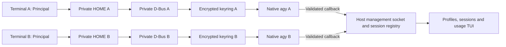

# Native Codex and Antigravity account architecture

Checked 2026-10-10. This document describes the current local management layer, not the historical Docker task executor.

## Use the TUI

1. Open `principal`, enter `/profiles`, and press Tab until Antigravity is selected.
2. Press **n**, enter a name such as `personal`, and submit. When Linux dependencies are available, Principal creates an experimental isolated profile and hands the terminal to native `agy`.
3. Complete the native Google OAuth flow, including any first-use onboarding. Choose the account intended for this profile. Exit native Antigravity to return to Principal.
4. Repeat for `work`. Select either profile and press **s** to launch it in a chosen project. In another terminal, open Principal and launch the other profile.
5. Open `/usage` and select Antigravity. New isolated profiles already include Principal's statusline command. Account identity and quota appear only when native callbacks supply them. Refresh never sends an inference request or queries a private quota endpoint.

**a** references the existing shared native login, not a new sign-in. Shared native profiles and new isolated profiles coexist; shared credentials are not copied into isolated profiles. Existing profiles remain shared until you explicitly add and sign into a new isolated profile. The fallback UI explains the shared login when isolation dependencies are unavailable.

## The architectural difference

| Concern | Current Codex integration | New Antigravity integration |
|---|---|---|
| Native selector | `CODEX_HOME` chooses profile configuration/state | No validated equivalent flag/environment selector; Principal supplies a private HOME and XDG directories |
| Credential domain | Native credential persistence selected by Codex configuration; OS credential-store behavior remains native-owned | Native Linux Secret Service is placed on a private D-Bus session with a private encrypted GNOME keyring |
| Shared daemon | Supported installed version launches with `--no-daemon`, avoiding a shared server's login state | Principal owns a short-lived isolation helper, bus and keyring around each native invocation |
| Sign-in | Native `codex login`, including supported `--device-auth` | Native full `agy` interface initiates Google sign-in if its private namespace lacks a saved login |
| Persistence | Same `CODEX_HOME` for login, launch, account queries and resume | Same private HOME/keyring files across launches; a fresh private bus/keyring daemon is unlocked each time |
| Account evidence | Official app-server account read | Process-bound statusline account field; absence means not verified |
| Quota evidence | Official app-server rate-limit read, normalized as rate limits | Optional native statusline quota buckets, normalized as percentage remaining with reset times |
| Session history | Official list/resume interfaces and version-validated local rollout copying | IDs observed through statusline can be resumed when native help confirms the flag; native picker otherwise |
| Cross-profile copy | Completed supported local Codex rollouts can be independently copied using native fork identity | Not implemented: no documented equivalent cross-account import was verified |
| Parallelism | Separate profile directories; native credential refresh still requires real-account validation | Different profiles may run concurrently; one active native invocation per isolated profile protects its keyring from concurrent writers |
| Portability | Management is currently Linux/WSL even where native Codex supports other systems | This isolation implementation requires Linux Secret Service and GNOME keyring; macOS/Windows need different adapters |

Codex exposes structured account, limit and thread interfaces, so its adapter can ask the native runtime specific read-only questions. Antigravity's current integration is event-driven: native statusline JSON is evidence about the running process, not a provider-wide inventory API. Its account identity is a native report, not proof that all tokens will refresh successfully. API-key billing remains distinct from subscription quotas. Sources: [Codex authentication](https://developers.openai.com/codex/auth), [Codex app-server](https://developers.openai.com/codex/app-server), [Antigravity authentication](https://www.antigravity.google/docs/cli/install/), [Antigravity statusline](https://antigravity.google/docs/cli/statusline/).

## Antigravity launch and credential boundaries

Each isolated profile stores native configuration beneath `management/profiles/<id>/.gemini/antigravity-cli`. Its HOME root also owns private configuration, cache, state and keyring files. Principal does not copy host Google credentials, passwords or SSH configuration into it. Conversation history is copied only through the explicit experimental history action.

A randomly generated keyring unlock secret is stored in the host desktop Secret Service under a dedicated Principal/profile attribute pair. It is not the user's Google password. The foreground launcher reads it and supplies it through an anonymous pipe (fd 3), rather than an environment variable, command-line argument or plaintext password file. The private GNOME keyring uses it to encrypt its persistent store. Native Antigravity remains responsible for its own token storage and refresh; Principal does not claim that every native file is encrypted.

Each invocation creates a short private runtime directory for its D-Bus socket, avoiding long Unix socket paths. The helper starts private D-Bus and keyring processes, launches the official native executable, and reports the actual agent PID through fd 4. Principal registers that PID and checks callback ancestry before binding account/session/quota observations. The callback receives the host management socket explicitly because its private HOME/XDG state would otherwise point at a different manager.

Stopping or exiting the invocation cleans up its private helper services and runtime directory while keeping persistent profile state. The manager refuses a second active or uncertain invocation on that isolated profile, including launches from another Principal terminal. Different profiles use independent keyring files and bus sessions. Profile removal preserves credentials/history for recovery, as with other providers.

All these processes run under the same OS user, on the same filesystem. There is no Docker container, VM or security sandbox added by Principal. Different account profiles do not create separate project files: use different Git worktrees when agents must edit independently. A malicious same-user process can still access files/processes allowed to that OS user.

## Updates and graceful degradation

Antigravity is no longer blocked solely because its version differs from a hardcoded tested release. Native launching does not depend on a version pin. A bounded `--help` probe verifies the resume flag separately; failure disables only that integration. Statusline callbacks validate supported fields individually, ignore extra fields and omit malformed quota values. If quota shape changes, account/session observations can still work, with an explicit profile diagnostic. Missing optional quota stays unavailable. Accepted callback evidence verifies that interface only, never two-account authentication.

Cached quota is timestamped and may become stale. An unknown quota is not 100 percent, and profiles referring to the same account do not add their allowances together. Native auth expiration, revoked consent, browser failures or provider-side changes may still require user-controlled sign-in. Capability probes cannot guarantee compatibility with all future releases or internal native credential changes.

## Explicit limitations and remaining validation

- **Experimental:** synthetic tests verified concurrent keyring separation, restart persistence, encrypted private keyring files, native PID reporting and owned stop cleanup. They do not validate two real Google accounts, native OAuth return routing, native token persistence or natural token refresh.
- **Linux dependencies:** `dbus-daemon`, `gnome-keyring-daemon`, `gdbus`, `secret-tool` and an unlocked host Secret Service are required. WSL needs a working Linux keyring setup; Windows desktop accounts/processes are not imported. No macOS/Windows isolation adapter is included.
- **Native sign-in handoff:** no supported login-only CLI interface was found. The native agent owns browser OAuth. Principal relays supported Google HTTPS login links launched through its `xdg-open` shim to the host opener; direct portal calls are not proxied. If the host desktop or link format is unsupported, use the native printed link. Simultaneous sign-ins may encounter native OAuth listener collisions; sign into profiles sequentially first.
- **One active agent per isolated profile:** conservative keyring-writer protection. Separate profiles can run in parallel, but several agents sharing one isolated profile are currently refused. Uncertain invocations must be resolved before restarting that profile.
- **Private HOME changes tool context:** Git/SSH dotfiles, global settings, browser helpers and shell tools may behave differently. Project contents and system binaries remain accessible. Principal does not silently copy sensitive dotfiles.
- **Direct `agy` remains shared:** launch through the selected Principal profile for isolation. Typing bare `agy` in an unrelated terminal uses its usual native login and does not inherit Principal's profile selection.
- **Experimental local history snapshots:** SQLite history matching the supported contracts can be copied explicitly between isolated profiles, retaining native IDs. The inspected baseline was 1.3.3; future schemas are checked instead of relying on version-string equality. Opaque records are preserved, but schema matches do not prove protobuf/native cross-account continuation compatibility. This is a local storage operation, not native `/fork` or an official cross-account import API. See [history copying](ANTIGRAVITY_HISTORY.md).
- **No indefinite-login guarantee:** native credentials may expire or be revoked. Losing the host unlock secret does not silently reset an existing profile keyring. Provider policies and subscription terms still apply.

Before labeling independent authentication verified, a user should sign into two legitimately authorized test accounts, confirm distinct native identities and quotas, close both tools, reopen them without authentication prompts, sign out of one and confirm the other remains authenticated, then verify natural refresh after its normal token lifetime. These checks must use provider-supported flows and must not disturb unrelated active accounts.
