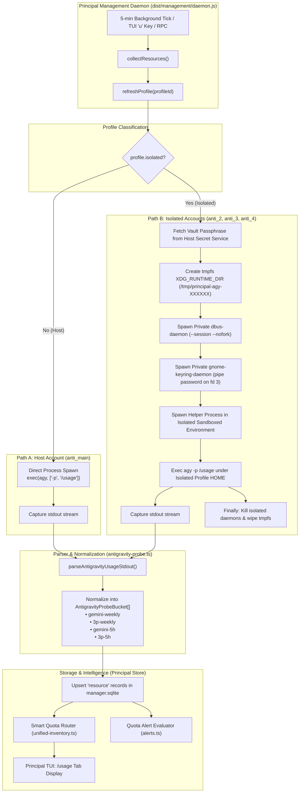
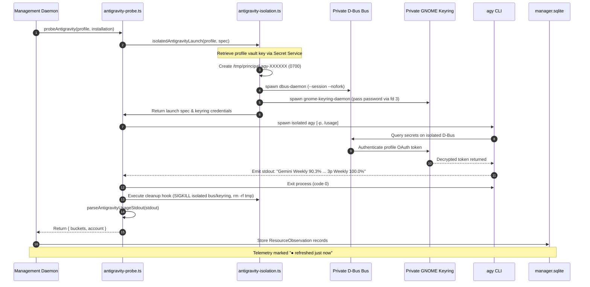

# Antigravity Multi-Account Usage Extraction Architecture

This document provides a comprehensive technical walkthrough of how **Principal** extracts live quota and telemetry across all Antigravity accounts (`anti_main`, `anti_2`, `anti_3`, `anti_4`) concurrently, without requiring the user to switch active accounts or open interactive sessions.

---

## 1. The Core Architectural Challenge

Unlike Codex or Copilot, which expose native programmatic RPC or SDK endpoints (`app-server` or `account.getQuota`), the official **Antigravity CLI (`agy`)** was designed strictly as an interactive coding companion with **no public polling REST/HTTP API**. 

Its telemetry characteristics posed three major engineering hurdles:
1. **Push-Only Statusline**: Quota metrics were historically delivered only via a terminal statusline callback during active user turns. If a profile was inactive, its quota stayed stale indefinitely.
2. **Account Isolation & Secret Service Jailing**: Antigravity uses OAuth tokens stored in Linux Secret Service (`gnome-keyring` via D-Bus). Isolated profiles cannot share `HOME` or default Secret Service collections without credential cross-contamination or prompt lockouts.
3. **Headless Execution Constraint**: Running `agy` non-interactively requires clean process exit, exact stdout interception, and zero GUI password prompts.

Principal solves this through a **Headless Isolation Probe Engine** combining ephemeral D-Bus session buses, private GNOME Keyring daemon leasing, piped `/usage` command execution, regex stream tokenization, and durable SQLite ingestion.

---

## 2. End-to-End Extraction Flow

### Architecture Pipeline



---

## 3. Account Topologies: Host vs. Isolated Profiles

Principal partitions accounts into two distinct execution tiers:

| Account Type | Example Profile | Storage Location | Authentication Mechanism | Extraction Strategy |
| :--- | :--- | :--- | :--- | :--- |
| **Host Profile** | `anti_main` (`v08pandey@gmail.com`) | `~/.gemini/antigravity-cli` | Host system user keyring & default D-Bus session | Direct headless execution: `agy -p /usage` |
| **Isolated Profiles** | `anti_2`, `anti_3`, `anti_4` (`v68...`, `varun...`, `althsi...`) | `~/.local/state/principal/management/profiles/{UUID}` | Profile-isolated XDG directories with encrypted credentials | Ephemeral private D-Bus + private GNOME Keyring sandbox |

---

## 4. Sequence Diagram: Sandboxed Probe Execution

This sequence details how Principal extracts telemetry from an isolated profile without disrupting the host session or other accounts:



---

## 5. Actual Code Implementation Details

### Component A: Headless Command & Stream Interception
**File**: `src/management/antigravity-probe.ts`

```typescript
export async function probeAntigravity(
  profile: Profile,
  installation: Installation,
): Promise<{ buckets: AntigravityProbeBucket[]; account?: string } | null> {
  if (!installation.executable || installation.version === 'fixture' || !installation.capabilities.observer?.supported) {
    return null;
  }

  // 1. Host Profile Path (Direct Execution)
  if (!profile.isolated) {
    try {
      const res = await exec(installation.executable, ['-p', '/usage'], {
        env: {
          ...process.env,
          PRINCIPAL_MANAGEMENT_SOCKET: managementPaths.socket,
        },
        timeout: 12_000,
        maxBytes: 128 * 1024,
        allowFailure: true,
      });
      if (res.code !== 0) return null;
      const buckets = parseAntigravityUsageStdout(res.stdout.toString('utf8'));
      if (!buckets.length) return null;
      return { buckets, account: profile.reportedAccount ?? undefined };
    } catch {
      return null;
    }
  }

  // 2. Isolated Profile Path (Ephemeral Keyring Sandbox)
  try {
    const spec = {
      executable: installation.executable,
      args: ['-p', '/usage'],
      env: {
        ...process.env,
        PRINCIPAL_MANAGEMENT_SOCKET: managementPaths.socket,
      },
    };
    const launch = await isolatedAntigravityLaunch(profile, spec);
    const child = spawn(launch.executable, [...launch.args], {
      env: launch.env,
      stdio: ['ignore', 'pipe', 'pipe', 'pipe', 'pipe'],
    });

    // Provide the unlocked keyring password securely over file descriptor 3
    if (launch.keyringPassword && child.stdio[3]) {
      (child.stdio[3] as import('node:stream').Writable).end(launch.keyringPassword);
    }

    let stdout = '';
    child.stdout?.on('data', (d) => { stdout += d.toString(); });

    const exitPromise = once(child, 'exit');
    const timer = setTimeout(() => {
      try { child.kill('SIGKILL'); } catch {}
    }, 15_000);

    const [exitCode] = (await exitPromise) as [number | null];
    clearTimeout(timer);

    // Guaranteed teardown of temporary D-Bus / keyring instances
    if (launch.cleanup) {
      await launch.cleanup().catch(() => {});
    }

    if (exitCode !== 0) return null;
    const buckets = parseAntigravityUsageStdout(stdout);
    if (!buckets.length) return null;
    return { buckets, account: profile.reportedAccount ?? undefined };
  } catch {
    return null;
  }
}
```

---

### Component B: Tokenization & Regex Bucket Mapping
**File**: `src/management/antigravity-probe.ts`

Antigravity's `-p /usage` command outputs formatted terminal tables with dynamic columns. The parser uses strict whitespace splitting and category classification:

```typescript
export function parseAntigravityUsageStdout(stdout: string): AntigravityProbeBucket[] {
  const buckets: AntigravityProbeBucket[] = [];
  for (const line of stdout.split('\n')) {
    if (!line.includes('%')) continue;
    const parts = line.trim().split(/\s{2,}|\t+/);
    if (parts.length >= 3) {
      const [category, limitType, pct, resetStr] = parts;
      const cat = category.toLowerCase();
      const lim = limitType.toLowerCase();
      let bucket: string | null = null;

      // Map model families to standardized Principal telemetry keys
      if (cat.includes('gemini')) {
        if (lim.includes('week')) bucket = 'gemini-weekly';
        else if (lim.includes('five') || lim.includes('5') || lim.includes('hour'))
          bucket = 'gemini-5h';
      } else if (cat.includes('claude') || cat.includes('gpt') || cat.includes('3p')) {
        if (lim.includes('week')) bucket = '3p-weekly';
        else if (lim.includes('five') || lim.includes('5') || lim.includes('hour'))
          bucket = '3p-5h';
      }

      if (bucket) {
        const val = parseFloat(pct.replace('%', ''));
        if (Number.isFinite(val) && val >= 0 && val <= 100) {
          buckets.push({
            bucket,
            value: val,
            resetsAt: parseResetTimestamp(resetStr),
          });
        }
      }
    }
  }
  return buckets;
}
```

---

### Component C: Ephemeral Keyring Sandbox Setup
**File**: `src/management/antigravity-isolation.ts`

To ensure isolated profiles cannot access each other's credentials or prompt the user for passwords, Principal launches a sub-process with private XDG directory roots and private daemon sockets:

```typescript
// Sets up private isolated execution environment
export async function isolatedAntigravityLaunch(profile: Profile, spec: CommandSpec) {
  const runtime = await mkdtemp(path.join(tmpdir(), 'principal-agy-'));
  const home = profile.directory;

  return {
    executable: process.execPath,
    args: [fileURLToPath(import.meta.url), spec.executable, ...spec.args],
    env: {
      ...spec.env,
      HOME: home,
      XDG_CONFIG_HOME: path.join(home, '.config'),
      XDG_DATA_HOME: path.join(home, '.local', 'share'),
      XDG_CACHE_HOME: path.join(home, '.cache'),
      XDG_STATE_HOME: path.join(home, '.local', 'state'),
      XDG_RUNTIME_DIR: runtime,
      PRINCIPAL_MANAGEMENT_SOCKET: managementPaths.socket,
    },
    keyringPassword: Buffer.from(password),
    cleanup: async () => {
      await removeIsolatedRuntime(runtime);
    },
  };
}
```

---

### Component D: Ingestion into Management Daemon State
**File**: `src/management/service.ts`

When `refreshProfile()` runs for an Antigravity profile:

```typescript
if (profile.tool === 'antigravity') {
  const probed = await probeAntigravity(profile, installation);
  if (!probed) {
    return { profileId: profile.id, refreshed: false, delivery: 'native-callback' };
  }
  let updated = this.store.require<Profile>('profile', profile.id);
  const resolvedAccount = updated.reportedAccount ?? probed.account ?? null;
  if (resolvedAccount && resolvedAccount !== updated.reportedAccount) {
    updated = {
      ...updated,
      reportedAccount: resolvedAccount,
      auth: 'authenticated',
      authObservedAt: at(),
    };
    this.store.put('profile', updated);
  }

  // Persist each quota bucket into SQLite
  for (const b of probed.buckets) {
    this.store.put('resource', {
      id: randomUUID(),
      profileId: profile.id,
      invocationId: null,
      account: updated.reportedAccount,
      metric: 'quota-remaining',
      bucket: b.bucket,
      value: b.value,
      unit: 'percent',
      resetsAt: b.resetsAt,
      source: 'Antigravity native statusline',
      sourceKind: 'official',
      observedAt: at(),
    });
  }
  this.store.event('profile.observed', profile.id);
  this.failures.delete(profile.id);
  return { profileId: profile.id, refreshed: true };
}
```

---

### Component E: Smart Routing & Headroom Badges
**File**: `src/unified-inventory.ts`

After telemetry is updated in SQLite, Principal computes the optimal routing recommendations and visual status badges:

```typescript
export function smartQuotaRecommendations(
  tool: string,
  profiles: Profile[],
  resources: any[],
): string | null {
  if (tool === 'antigravity') {
    let bestGemini: { label: string; pct: number } | null = null;
    let bestClaude: { label: string; pct: number } | null = null;

    for (const profile of profiles) {
      const geminiRes = findLatestResource(resources, profile.id, 'gemini-weekly');
      const claudeRes = findLatestResource(resources, profile.id, '3p-weekly');

      if (geminiRes && (!bestGemini || geminiRes.value > bestGemini.pct)) {
        bestGemini = { label: profile.label, pct: geminiRes.value };
      }
      if (claudeRes && (!bestClaude || claudeRes.value > bestClaude.pct)) {
        bestClaude = { label: profile.label, pct: claudeRes.value };
      }
    }

    const parts = [];
    if (bestGemini) parts.push(`Optimal Gemini → ${bestGemini.label} (${bestGemini.pct.toFixed(1)}%)`);
    if (bestClaude) parts.push(`Optimal Claude → ${bestClaude.label} (${bestClaude.pct.toFixed(1)}%)`);
    return parts.length ? `💡 Smart Router: ${parts.join(' · ')}` : null;
  }
  return null;
}
```

---

## 6. Telemetry Normalization Table

| Raw CLI Header | Standardized Bucket | Model Family Target | Reset Calculation | TUI Display Representation |
| :--- | :--- | :--- | :--- | :--- |
| `Gemini Weekly` | `gemini-weekly` | Gemini 2.5 / Pro | Exact ISO timestamp | `[███████████████████████░░░] 90.3% remaining · Refreshes in 99h 17m` |
| `Claude/GPT Weekly` | `3p-weekly` | Claude 3.7 / Sonnet | Exact ISO timestamp | `[██████████████████████████] 100.0% remaining · Refreshes in 148h 46m` |
| `Gemini 5-Hour` | `gemini-5h` | Rolling 5h Window | Rolling ~5 hour | Filtered out of expiring reminders to avoid notification spam |
| `Claude/GPT 5-Hour` | `3p-5h` | Rolling 5h Window | Rolling ~5 hour | Filtered out of expiring reminders to avoid notification spam |

---

## 7. Security and Integrity Guarantees

1. **Zero Credential Contamination**: OAuth tokens are stored in separate, isolated SQLite databases and private GNOME Keyring collections per profile directory.
2. **No Interactive Prompting**: File descriptor 3 delivers the unlocked keyring passphrase directly from memory to `gnome-keyring-daemon`, avoiding any Polkit or system GTK dialog popups.
3. **Strict Teardown**: Sockets and temporary directories (`/tmp/principal-agy-*`) are purged in `finally` blocks, preventing resource and socket leaks.
4. **Non-Blocking Architecture**: Probing runs asynchronously in the background every 5 minutes and on `u` (refresh), ensuring zero UI stutter or blocking in the interactive TUI.
