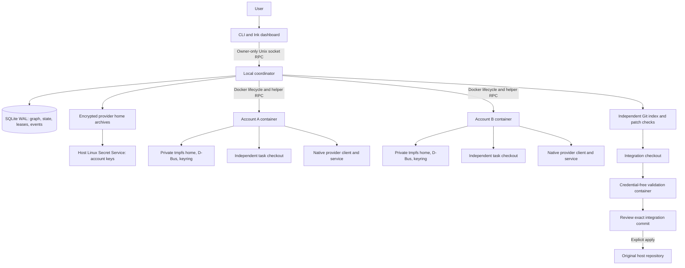

> Historical execution backend documentation. The current public TUI is account/session management only; chat and task execution described below are not exposed. See [native management](NATIVE_MANAGEMENT.md).

# Principal: current implementation architecture

Updated: 2026-10-07. Project: `/home/varun/principal`. Status: local development alpha, version 0.1.0.

This document describes the current source implementation, its recorded verification evidence, and limits that a reviewer should examine. The source takes precedence over this document. Historical prototype documents under `/home/varun/docs` describe earlier experiments; their token rotation, host mounts, Docker socket access, and quota multiplication assumptions are not the supported Principal architecture.

## 1. Purpose and operating model

Principal is a local Linux CLI for repository tasks distributed across a user's enrolled Codex and Antigravity accounts. A task graph specifies dependencies, instructions, read/write mode, allowed output paths, account/provider/model constraints, and fallback policy.

Principal uses native provider clients and provider-owned authentication state. It does not supply a paid API fallback. Provider account settings still determine access, model entitlement, quota, and any permitted spending. Multiple profiles do not establish independently additive provider allowances.

Two entry paths exist:

- **Explicit graph:** `/run --tasks FILE` inside the TUI schedules user-specified tasks.
- **Goal planning:** a Codex supervisor proposes a bounded graph, workers execute it, and a Codex supervisor reviews the integration and may propose bounded follow-up tasks.

### System diagram

## 2. Components and source map

| Component                      | Source                                                                        | Responsibility                                                                                                               |
| ------------------------------ | ----------------------------------------------------------------------------- | ---------------------------------------------------------------------------------------------------------------------------- |
| Installed launcher             | `bin/principal.mjs`                                                           | Select recorded Node executable and check native SQLite compatibility before loading the CLI.                                |
| CLI and RPC client             | `src/cli.ts`, `src/client.ts`                                                 | Parse commands; start/reconnect to the coordinator; present readable or JSON output.                                         |
| Coordinator                    | `src/daemon.ts`, `src/coordinator.ts`                                         | Unix socket server, task scheduling, account leases, provider lifecycle, collection, recovery, integration and supervision.  |
| Persistence                    | `src/store.ts`, `src/schema.ts`                                               | SQLite schema version 1, validated task/config/result schemas, sequenced events and actor leases.                            |
| Routing and quota              | `src/scheduler.ts`, `src/providers/quota.ts`                                  | Eligibility, account affinity, quota headroom, freshness, reserves and recognized provider failures.                         |
| Provider adapters              | `src/providers/index.ts`                                                      | Native account inspection, model inspection, quota parsing and logout capabilities.                                          |
| Host vault                     | `src/vault.ts`                                                                | AES-256-GCM archives, account keys in Secret Service, authenticated metadata and key-buffer cleanup.                         |
| Docker runtime                 | `src/runtime.ts`, `runtime/Dockerfile`                                        | Version-checked image build, container creation, mounts, resources, snapshot/restore and removal.                            |
| Container helper               | `runtime/entry.sh`, `runtime/worker.mjs`, `runtime/client.mjs`                | Private D-Bus/keyring, helper socket, provider process, journal, cancellation and terminal state.                            |
| Codex protocol                 | `runtime/rpc.mjs`, `src/generated/codex`                                      | App-server transport and pinned generated protocol reference. Generated types do not validate every live message at runtime. |
| Antigravity login and identity | `runtime/login*.mjs`, `runtime/login*.sh`, `runtime/antigravity-identity.mjs` | Temporary SSH login, proxy/CA environment restoration and observed native identity metadata.                                 |
| Antigravity permissions        | `runtime/antigravity-permissions.mjs`                                         | Scoped workspace grants, native denial detection and rejection of incomplete/partial results.                                |
| Shared redaction               | `runtime/redaction.mjs`, `src/util.ts`                                        | Recursive sensitive-property redaction and token redaction for text.                                                         |
| Repository handling            | `src/repository.ts`                                                           | Frozen bundle, independent clones/indexes, checkpoint verification, integration and exact-commit apply.                      |
| Supervisor bridge              | `src/supervisor.ts`, `runtime/mcp.mjs`                                        | Run-scoped bounded planning/review tools.                                                                                    |
| Observability                  | `src/agent-view.ts`, `src/presentation.ts`, `src/dashboard.tsx`               | Event replay, agent panels, readable logs/status and quota formatting.                                                       |
| Build workflows                | `scripts/workflow.mjs`, `scripts/record-runtime.mjs`                          | Build/test/check and smoke workflows under the recorded Node runtime.                                                        |

## 3. Host processes and persistence

The CLI is a client. The coordinator is a detached process whose direct entry acquires a lifetime `flock`; detaching the dashboard or closing the CLI does not cancel a run. A restrictive umask precedes socket creation; RPC uses an owner-only Unix socket with JSON request/response envelopes. Client startup readiness is reset after rejection; socket disappearance/refusal clears cached readiness for subsequent calls. Interrupted mutating requests are not automatically replayed.

Default locations, subject to XDG environment overrides:

| Location                                              | Contents                                                                                  |
| ----------------------------------------------------- | ----------------------------------------------------------------------------------------- |
| `/home/varun/principal`                               | Project source, runtime scripts, documentation and tests.                                 |
| `~/.local/bin/principal`                              | Installed launcher symlink.                                                               |
| `~/.local/state/principal/principal.sqlite`           | Accounts, pools, quota observations, runs, tasks, attempts, events and leases.            |
| `~/.local/state/principal/vault/<account-id>.enc`     | Encrypted provider home snapshot.                                                         |
| `~/.local/state/principal/runs/<run-id>/`             | Frozen Git bundle, attempt workspaces, trusted indexes, patches and integration checkout. |
| `~/.local/state/principal/daemon.sock` / `daemon.log` | Local RPC and coordinator diagnostics.                                                    |
| `~/.config/principal/`                                | Local configuration.                                                                      |

A read task normally stores its report in `task.result` in SQLite. It does not automatically create a report file. Writing tasks produce workspace changes which the coordinator converts into checkpoints.

A run persists its repository base, approved account IDs, configuration, task graph and resolved image digest. Image rebuilds affect new runs; an old run retains its frozen image during resume.

## 4. Account enrollment, storage and restore

### Common lifecycle

1. Allocate an account UUID and a random 32-byte archive key in the host Secret Service. Acquire an account lease.
2. Create a container with a private tmpfs home and control directory.
3. Restore an existing encrypted provider-owned home archive over stdin before starting the private keyring.
4. Start private D-Bus, initialize/unlock the private Secret Service, and configure provider behavior.
5. Complete native login or inspect restored native state.
6. For an account without an established identity, save the encrypted home before identity inspection. This preserves a successful login if identity format inspection fails; it does not make the account ready.
7. Inspect reported identity; reject duplicate identity registrations within a provider and identity changes during reauthentication.
8. Snapshot state, record enrollment and inspect quota. `ready` means enrollment completed; it does not guarantee that a particular model or quota scope is usable.
9. Remove the login runtime and release its lease after successful cleanup in the enrollment path.

Existing enrolled identities are checked before their archive is replaced by the enrollment flow. Native login URLs/codes are returned to the live client rather than stored as run events.

### Provider-specific authentication

| Provider    | Login                                                                                                            | Provider-owned state                                                                                    |
| ----------- | ---------------------------------------------------------------------------------------------------------------- | ------------------------------------------------------------------------------------------------------- |
| Codex       | Native ChatGPT device code through app-server.                                                                   | Native file credential mode in private `.codex/auth.json`; included in the encrypted home archive.      |
| Antigravity | Native OAuth through a temporary loopback-only SSH server and PTY, running `agy --output-format json -p /usage`. | Native `.gemini/antigravity-cli/antigravity-oauth-token` when present, or private Secret Service state. |

The Antigravity identity adapter decodes observed `id_token` metadata from the native file. It uses the older observed keyring lookup only when the file is absent. Unsupported payloads fail closed. This is identity metadata from provider-owned storage, not independent JWT signature verification or proof that allowances are independent.

The SSH login server uses ephemeral keys, public-key authentication and a random loopback port. Its root SSH master receives limited login capabilities including `AUDIT_WRITE`; inference workers retain zero effective capabilities. The launcher restores an allowlist of proxy and CA environment variables from an owner-only control file because SSH does not inherit them automatically.

### Vault details

- AES-256-GCM with a fresh nonce per save; account ID, provider and generation are authenticated metadata.
- A separate archive key is stored in the host Linux Secret Service for each account.
- New generation-addressed archives are durably written before the database generation pointer advances; previous archives remain readable on a failed commit. Generation 0 reads the legacy filename. Replay detection is relative to the database pointer and does not protect against coordinated database/vault rollback. Plaintext home data is held in container tmpfs or transient process buffers.
- Private keyring passwords are retained inside the encrypted `.config` snapshot for cold restoration.
- Key Buffers are wiped on save/load completion and exceptions. This does not promise erasure of every JavaScript string or native crypto copy.
- Snapshots retain `.codex`, `.gemini`, `.config` and private keyrings, excluding known Codex log/logs and Antigravity log/logs/crashes directories.
- Provider cache and conversation state remain because they can be needed for native restore/resume. Archives have a 256 MiB capture limit; encryption/serialization still buffers data in host memory. Streaming encryption and unlimited history retention are not implemented.

## 5. Container isolation and permissions

Inference workers use Docker's default seccomp policy, `--cap-drop ALL`, `no-new-privileges`, resource limits and private home/control/tmp tmpfs mounts. With a task workspace mounted, the worker root filesystem is read-only. `/workspace` contains only the independent task clone; `.git` is separately mounted read-only.

- **Read task:** `/workspace` is a read-only bind mount.
- **Write task:** `/workspace` is writable; allowed final changes are enforced by the coordinator's independent patch checks.
- The original checkout, host home and Docker socket are not mounted in inference workers.
- Native credentials and the helper live in the same account container. Provider/helper/tool processes share a Unix identity; Docker isolates accounts and the host, but does not isolate the worker's tools from that account's own native credential store.
- Runtime and validation containers use a dedicated Docker bridge with inter-container communication disabled, with an optional configured proxy. Host-loopback SSH publication remains available for login. There is no enforced provider-only egress allowlist or proof that shell tools cannot contact the host network or arbitrary internet endpoints.

### Codex execution

The image includes Codex 0.160.1 and its required sibling `codex-code-mode-host`. App-server JSON-RPC drives thread start/resume and turns. Native multi-agent behavior is disabled. Interactive server approval requests are denied.

The thread uses `danger-full-access` with turn policy `externalSandbox` and network access enabled. Docker supplies the filesystem/process boundary. Nested Bubblewrap namespace creation is not enabled by weakening Docker seccomp.

### Antigravity execution

Supported adapter targets are 1.3.0 and 1.3.1; the current verified image contains 1.3.1. Versions outside the supported list fail during image build/configuration.

The helper writes native permission settings, retaining configured deny rules. It adds `read_file(/workspace)` and adds `write_file(/workspace)` only for writable workspace mounts. Default command allowance is `command(*)`; default denies include `mcp(*)` and `execute_url(*)`. These defaults permit broad commands inside the container and are not an egress policy.

Workers use stream-json input/output with a JSON output schema and a native print timeout. The helper writes the prompt, keeps stdin open until the result, then closes stdin. It reads progress/results while the process runs. Native headless permission denials are reported as failed attempts. Empty results and timeout notices returning partial output are not accepted as completion. A hard process-group timeout adds a five-second cleanup grace and reports an explicit timeout error.

The permission bypass flag is not used. Read-only mounting and independent checkpoint checks remain effective regardless of the model's reported success.

## 6. Task execution, output acceptance and routing

### Dispatch and acceptance

1. Validate graph structure and explicit write permissions; persist the run and frozen source bundle.
2. Wait for accepted completed dependencies.
3. Select an eligible account and atomically acquire its lease.
4. Record dispatch intent; create a private checkout and account runtime; restore native state.
5. Start the helper-managed provider process; ingest sequenced events and state.
6. After the provider stops its turn/process, derive a checkpoint with coordinator-owned Git metadata.
7. Validate the structured task result, expected outputs and allowed changed paths.
8. Persist result/checkpoint/attempt state; remove the runtime and perform the relevant lease cleanup.

Provider turn completion alone does not prove task success. An invalid or blocked structured result, missing expected patch, rejected path, denial, timeout or checkpoint failure can require review.

### Selection policy

Accounts must belong to the frozen run pool, be ready, not be leased, not be excluded and not be in retry backoff. Pins accept exact labels or IDs. Provider/model constraints, same-account affinity, fallback rules, provider order, restrictive within-provider headroom, assignment recency and stable ID determine selection.

Default settings:

| Setting                                       | Default                                        |
| --------------------------------------------- | ---------------------------------------------- |
| Worker slots                                  | 4                                              |
| Per-container CPU / memory / PID limit        | 2 CPUs / 2048 MiB / 512 PIDs                   |
| Host runtime memory admission budget          | 75% of host physical memory                    |
| Reserved allowance                            | 10%; reported headroom must exceed the reserve |
| Quota freshness                               | 300 seconds                                    |
| Permit unknown headroom                       | false                                          |
| Maximum handoffs / transient retries          | 5 / 2                                          |
| Attempt timeout                               | 1800 seconds                                   |
| Graph task bound / supervisor revision rounds | 20 / 2                                         |

Account leases serialize Principal-managed login, inspection, probes and inference. They do not prevent another unrelated program from using the same provider account, or prove that an account's worker cannot launch another network client.

### Quota observations

Codex reports provider limit buckets; Antigravity reports `/usage` group buckets. Store original numeric precision, separate buckets, reset times, observation timestamps, source and unknown/unsupported/stale state. Display percentages with two decimal places; this is formatting, not a guarantee of provider measurement accuracy. Contemporary epoch seconds, epoch milliseconds and ISO dates are accepted for resets.

Model-family scope must be known before reported percentages become routable headroom. The observed Antigravity groups can report percentages without model IDs, so the UI can show usage while routing headroom remains unknown.

`allowUnknownQuota` permits otherwise eligible unknown headroom. **An explicitly stale observation is rejected by the scheduler even when this option is enabled.** Cross-provider percentages are not summed or used as comparable capacity units.

Background probes use isolated containers, are coalesced and capped at two concurrent probes, and back off after actual failures. Busy acquisition returns the existing observation without degrading it or incrementing backoff. Active Codex quota notifications are ingested from app-server.

### Failure classification and handoff

Only recognized structured provider discriminants can mark quota exhaustion, authentication failure, account restriction, model unavailability or transient failure. Task summaries, compiler/tool prose and generic strings cannot disable accounts or block quota. The old text classifier remains exported in source, but coordinator account/routing transitions use `classifyProviderFailure`.

Unrecognized or string-only provider errors conservatively require review. Antigravity native error strings therefore do not establish automatic quota/auth handoff behavior. Exhaustion can block an affected model pending a fresh observation; account restrictions can disable routing. Transient retries are bounded and delayed.

Native conversation IDs are reused only on the same account. Cross-account transfers start new native conversations with accepted file checkpoints and available task context. This is not cross-account native conversation migration or exactly-once external action execution.

## 7. Repository integrity, validation and apply

A clean committed source repository supplies a frozen Git bundle. Each attempt gets an independent clone, accepted dependency patches and its own prior checkpoint when applicable.

The coordinator clones a separate trusted Git administration area and stages the worker's worktree against a dependency baseline. It does not trust worker-modified Git configuration/indexes. Changed paths must satisfy task write patterns; changed `.git`, `.gitmodules` and `.gitattributes` path components and root `principal.config.json` are rejected. Ordinary `.gitignore` and `.github` paths remain permitted. Per-file and patch limits are 16 MiB and 32 MiB.

Changed Git modes must be deletion, regular file or executable regular file. New/changed symlinks and submodules are rejected; changed filesystem artifacts must be regular files. Imported checkpoint patches receive path and mode validation too. Existing unchanged repository symlinks remain possible. Patch hashes detect changes relative to a stored hash, not arbitrary malicious changes to both local database and artifacts.

Integration applies accepted patches in dependency order into a separate checkout. Configured validation runs without account credentials and with integration Git administration read-only. Validation must not mutate the reviewed source tree. Validation/test commands provide project-specific checks; their existence does not prove arbitrary generated code is safe.

Apply requires a validated exact integration commit, a ready-for-review run, and the expected clean original repository base. The coordinator fetches the exact commit, rechecks changed file paths and modes, and uses a fast-forward with host hooks disabled. Host builds/IDE behavior after apply remain outside the worker container boundary.

## 8. Supervision

Only a Codex supervisor receives the run-scoped MCP bridge. Six tools expose bounded graph proposals, task status/results, accepted patch reading and task cancellation:

`submit_task_graph`, `propose_task_revision`, `list_task_status`, `read_task_result`, `read_artifact`, `cancel_task`.

The bridge does not expose account credentials, Docker control, arbitrary host file reads or accounts outside the pool. Revisions add tasks within the configured task/round limits, retain the pool and approved write-path patterns, and cannot modify existing task specifications.

Antigravity automatic supervision remains gated pending enforceable native delegation restrictions. Shell-capable workers can execute programs inside their container; instructions against delegation are not proof that arbitrary repository code cannot spawn a network client.

## 9. Persistence, recovery and cleanup

SQLite WAL stores schema-versioned account/run/task/attempt records, actor leases and sequenced events. Event insertion and replay cursor advancement occur in one transaction. Helper journals are private container control files; replay reconstructs progress after client detachment and supports coordinator reconnection.

Recovery marks interrupted planning and missing workers as requiring review. Explicit resume is required for ambiguous outcomes. Exited/missing attempt containers are removed before startup releases their leases. Pruning rejects active work and removes containers matching both the managed label and exact run label before deleting run files/records.

Actor cleanup uses a shared stop-and-release guard: a running or uninspectable runtime retains its account lease. Intended container names are recorded before actor creation, including failure paths. Planner/supervisor bridge shutdown runs despite cleanup failure. Pruning rejects active runs and removes residual run actor leases only after stop checks; account deletion refuses to discard credentials when cleanup leaves a lease. Regression checks exercise these boundaries, while complete live crash/fault coverage remains pending.

Worker/helper processes share a UID and control-directory access. Their journals and protocol provenance markers are recovery information, not tamper-proof provider attestations. Docker shares the host kernel. Crash boundaries, orphan ownership and external side-effect ambiguity require further live fault-injection evidence.

## 10. Observability and redaction

The Agents dashboard replays sequenced events into per-attempt activity, showing task/account/provider/model, state, elapsed time, latest action/message, token usage and results. Wide terminals display simultaneous panels; narrow terminals paginate. Polling updates approximately every two seconds. Retries have separate activity state; dashboard detach leaves the coordinator running.

Readable logs combine token fragments into messages; raw/JSON modes expose structured event streams. Status parses stored structured results. Reports and artifacts can contain sensitive repository data even after credential-pattern redaction.

Redaction recursively replaces recognized sensitive object properties before JSON serialization. Text token patterns require appropriate boundaries and handle complete quoted values. Malformed legacy event JSON is withheld during event reads rather than crashing the dashboard/logs or emitting potentially unredacted payloads. Redaction is a best-effort filter, not a general data-loss-prevention system.

## 11. Verification and remaining limits

Evidence is recorded in `docs/BUILD.json` and explained in `docs/AUDIT_REVIEW.md`. It records previous checks; the second audit reran automated/infrastructure checks while retaining older live inference evidence separately in `docs/SECOND_AUDIT_REVIEW.md`.

| Area                          | Recorded evidence                                                                                                                                                                                                                                                  |
| ----------------------------- | ------------------------------------------------------------------------------------------------------------------------------------------------------------------------------------------------------------------------------------------------------------------ |
| Build, syntax and regressions | 56 automated tests passed; recorded-runtime workflows exercised from Node 22.23.2 using Node 26.10.0.                                                                                                                                                              |
| Codex integration             | Two Free accounts ran parallel readers, read-only enforcement, a dependent writer, validation and apply in a temporary repository. Latest recorded run: `6a1ab610-9168-4194-ab4e-3bb24b0b2f70`.                                                                    |
| Antigravity                   | Native browser login, encrypted restoration, quota retrieval and a live random-marker read/write with structured output on 1.3.1, using `gemini-3.8-flash-medium` and scoped permissions. A 90-second repeat timed out; the final bounded 240-second check passed. |
| Docker/login                  | Read-only mounts, writable tmpfs, default seccomp, zero worker capabilities, SSH PTY, synthetic keyring cold restore, telemetry exclusion and cache retention.                                                                                                     |
| Dashboard                     | Concurrent rendering fixtures and actual TTY replay/navigation/detach.                                                                                                                                                                                             |
| Recovery/cleanup              | Regression mocks establish tested ordering; they do not establish complete live crash recovery.                                                                                                                                                                    |

Remaining release evidence includes native OAuth refresh, quota exhaustion and handoff, same-account conversation resume, two-account concurrent Antigravity isolation, supervisor bounds and cleanup failures, daemon crash/restart fault boundaries, integration conflicts, and broader host/rootless portability. Cross-provider/account allowance independence and model entitlement must not be inferred from profile counts or a displayed quota percentage.

Changes are local. No commit, push, npm publication or deployment is recorded.

## 12. Reviewer handoff

Read this file, `README.md`, `docs/STATUS.md`, `docs/AUDIT_REVIEW.md`, `docs/SECOND_AUDIT_REVIEW.md` and `docs/BUILD.json`, then verify claims against the source map above. Prioritize account lease ownership/cleanup, shared helper/worker trust, provider error provenance, quota scope/freshness, repository patch/index boundaries, exact-commit apply, stream lifecycle and recovery failure boundaries.

Separate confirmed code issues from plausible failure scenarios and unverified release claims. Cite concrete source locations and reproduction steps. Source review does not require reading real credentials or enrolling accounts. Live smoke scripts consume account allowance and create provider sessions; do not run them merely to inspect the architecture.

## Persistent interactive sessions

The additive schema 2 session layer is implemented in `src/sessions.ts`, with typed
entities in `session-types.ts`, context/artifact handling in `session-context.ts`,
and dirty-workspace capture/review/unstaged apply in `session-workspace.ts`.
`runtime/conversation.mjs` provides persistent native drivers; `src/chat.tsx` is
the Ink client. Session actors and maintenance share coordinator locks and account
leases with batch workers. See [the session contract](INTERACTIVE_SESSIONS.md) and
[recorded verification](INTERACTIVE_EVIDENCE.json).
