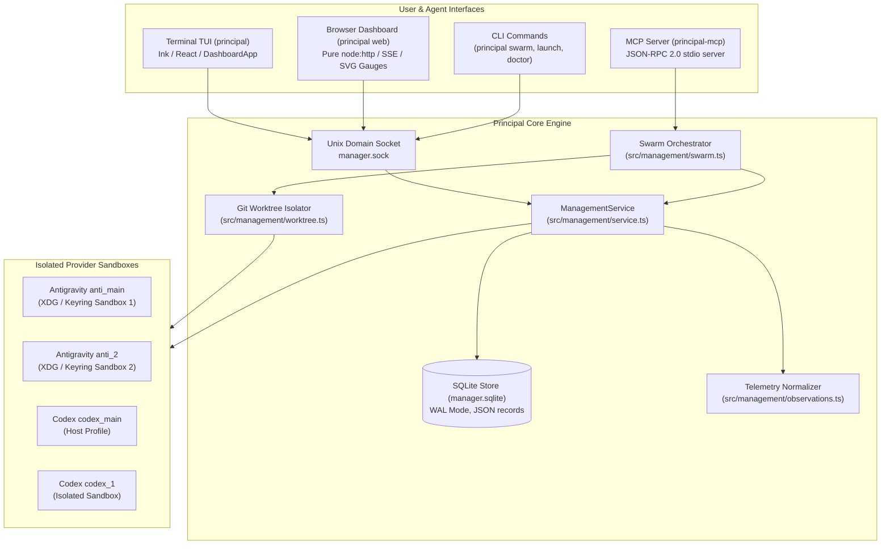

# Principal · Comprehensive System Handoff & Architecture Briefing for OpenAI Codex

**Target Agent:** OpenAI Codex (`cdx`) / Lead Orchestrator  
**Repository:** `/home/varun/principal`  
**Current Release:** `v0.1.5`  
**Date:** October 2026  
**Primary Maintainer:** Varun (`v08pandey@gmail.com`)  

---

## 1. Executive Summary & Product Identity

**Principal** is a Linux-first terminal and browser orchestration platform for managing multiple local AI coding agent accounts, native profiles, execution sessions, and quota observations across:
- **Google Antigravity** (`agy`)
- **OpenAI Codex** (`cdx`)
- **Anthropic Claude Code** (`cld`)
- **GitHub Copilot** (`copilot`)

### Core Philosophy
1. **Preserve Native Agent Ownership**: Principal does not reinvent model inference, token generation, or prompt loops. Users continue using the official agent binaries (`agy`, `codex`, `claude`).
2. **True Account Isolation**: Each registered profile operates in an isolated Linux sandbox (private `$XDG_DATA_HOME`, private `$XDG_STATE_HOME`, dedicated GNOME Keyring instances via ephemeral D-Bus sessions). This allows multiple accounts (e.g. 4 distinct Antigravity accounts) to run concurrently on the same machine without keyring collision or OAuth token overwriting.
3. **Unified Conversation History**: Multiple accounts of the same provider share a common system conversation history locally, eliminating duplicate data or lost threads when hot-swapping credentials.
4. **Multi-Agent Swarm Delegation**: Acts as a Model Context Protocol (MCP) server (`principal-mcp`) allowing Lead Agents (like Codex) to autonomously delegate subtasks to a parallel swarm of worker agents isolated in ephemeral Git worktrees with automatic quota balancing.
5. **Zero-Compile Portability**: Node 24+ based, standalone pre-packaged tarballs with zero-compilation runtime auto-discovery.

---

## 2. System Architecture & Component Map



### Detailed Subsystems

#### A. Core Management Daemon (`src/management/daemon.ts`, `service.ts`, `store.ts`)
- **Transport**: Single local daemon bound to a private Unix domain socket (`/run/user/1000/principal-management/manager.sock` or `$XDG_RUNTIME_DIR`).
- **Persistence**: SQLite database (`manager.sqlite`) in WAL mode with robust schema indexing. Stores profiles, active bindings, invocations, accounts, handoff tokens, and quota observations.
- **RPC Protocol**: Structured JSON-RPC methods (`snapshot`, `profiles.swap`, `profiles.add`, `profiles.rename`, `profiles.remove`, `resources`, `resources.refresh`, `handoff.export`, `handoff.import`, `handoff.inspect`, `diagnostics.report`).

#### B. Provider Isolation & Sandboxing (`src/management/antigravity-isolation.ts`, `providers.ts`)
- Antigravity stores tokens in the Linux GNOME Keyring / Secret Service. When multiple Google accounts are used, running them under the same user normally overwrites credentials.
- Principal spawns isolated D-Bus sessions running a private `gnome-keyring-daemon` for each profile under `~/.local/state/principal/management/profiles/<id>/`.
- Relays OAuth callbacks through a restricted host browser bridge (`browser-bridge.ts`, `browser-open.ts`).

#### C. Unified Shared Conversation History (`src/management/shared-history.ts`)
- Rather than cloning or segregating conversation SQLite databases per account, Principal binds profiles of the same provider to the canonical host conversation store.
- Accounts rotate seamlessly while retaining a single continuous thread history per provider on the machine.

#### D. Telemetry & Quota Engine (`src/management/observations.ts`, `unified-inventory.ts`)
- **Antigravity**: Telemetry is captured via statusline callbacks as `metric: 'quota-remaining'`, where `value` represents the remaining percentage (e.g. `82.5` = 82.5% remaining).
- **Codex & Claude**: Telemetry is captured via native `account/rateLimits/read` as `metric: 'rate-limit-used'`, where `value` represents the **percentage used** (e.g. `46` = 46% used, meaning `100 - 46 = 54%` remaining).
- **Headroom Calculation**: Principal uses `calculateHeadroom(r)`:
  - If `r.metric === 'rate-limit-used'`: `remaining = 100 - r.value`, `used = r.value`.
  - If `r.metric === 'quota-remaining'`: `remaining = r.value`, `used = 100 - r.value`.
- Supports 5-hour primary windows, weekly secondary limits, and monthly pools.

#### E. Browser Dashboard Microserver (`principal web`)
- Built in `src/management/web-server.ts` using built-in `node:http` (zero external dependencies).
- Serves `src/management/web/dashboard.html`: Single-Page Application with dark theme, real-time SVG circular quota dials, live reset countdown timers, profile action modals (Add, Hot Swap, Handoff, Rename, Remove), active agent session tables, and system diagnostics.
- Real-time updates delivered via Server-Sent Events (`/api/events`).
- **CSRF Protection**: All mutating JSON-RPC calls (`POST /api/rpc`) strictly enforce the `X-Principal-Request: 1` HTTP header.
- **Keyed In-Place DOM Reconciliation**: Never destroys `innerHTML` during periodic polls; updates existing elements in-place (`id="profile-card-${p.id}"`, `id="quota-card-..."`), eliminating layout jumps and keeping cards completely fixed on the screen.

#### F. Swarm Orchestrator & MCP Server (`principal-mcp`, `src/mcp/server.ts`, `src/management/swarm.ts`)
- Exposes 4 native MCP tools for Lead Agents:
  1. `principal_deploy_swarm`: Dispatches parallel worker tasks across available Antigravity or Codex accounts with Git worktree isolation.
  2. `principal_get_swarm_status`: Queries live execution state, worker logs, and unified diffs.
  3. `principal_cancel_swarm`: Aborts a running swarm safely.
  4. `principal_list_profiles`: Returns available profiles, accounts, authentication states, and headroom.
- **Git Worktree Isolation (`src/management/worktree.ts`)**: Creates ephemeral worktrees under `.git/principal-worktrees/swarm-<task-id>-<token>`. Workers make edits without dirtying the working tree. Upon completion, Principal extracts `git add -N . && git diff HEAD`, cleans up the worktree, and aggregates results for the lead orchestrator.

#### G. Node 24+ Polyglot Runtime Auto-Discovery (`bin/principal.mjs`)
- Solves Node version and `better-sqlite3` native addon ABI mismatches across different environments.
- Automatically inspects the current process, host-recorded runtime, FNM directories, NVM versions, Volta, ASDF, and system paths to find and launch a compatible Node 24+ binary transparently.

---

## 3. Repository File Map

```text
principal/
├── bin/
│   ├── principal.mjs              # Universal CLI launcher with Node 24+ runtime fallback
│   ├── principal-mcp.mjs          # Standalone MCP stdio server entrypoint
│   └── principal-codex-notify     # Codex statusline notification helper
├── dist/                          # Compiled TypeScript output (packaged in distribution)
├── docs/                          # Master technical documentation
│   ├── AGENT_CONTEXT.md           # Onboarding context map for AI agents
│   ├── AGENT_SWARM_ARCHITECTURE.md# Swarm orchestration architecture breakdown
│   ├── AGENT_SWARM_ORCHESTRATOR_GUIDE.md # Protocol for Lead Agents (Codex/Claude)
│   ├── WEB_DASHBOARD_ARCHITECTURE.md     # Web microserver & dashboard specification
│   ├── ACCOUNT_HANDOFF.md         # Armored token handoff & constraints architecture
│   ├── SHARED_CONVERSATION_HISTORY.md    # Shared conversation database design
│   ├── ANTIGRAVITY_PROFILES.md    # D-Bus & GNOME Keyring isolation details
│   ├── INSTALLATION.md            # Universal installer & multi-distribution guide
│   └── CODEX_HANDOFF.md           # (This document) Master Codex briefing
├── src/
│   ├── cli.ts                     # Main CLI command router (tui, web, swarm, doctor, handoff)
│   ├── management/
│   │   ├── daemon.ts              # Unix domain socket daemon lifecycle
│   │   ├── service.ts             # ManagementService - core business logic & RPC router
│   │   ├── store.ts               # SQLite ManagementStore with expression indexes
│   │   ├── model.ts               # TypeScript schemas and Zod models
│   │   ├── paths.ts               # XDG path resolvers (~/.local/state/principal/...)
│   │   ├── observations.ts        # Statusline and limit normalizers (Codex & Antigravity)
│   │   ├── providers.ts           # Provider detection, isolation capabilities & environment
│   │   ├── antigravity-isolation.ts # GNOME Keyring D-Bus daemon launcher
│   │   ├── shared-history.ts      # Provider conversation history unification
│   │   ├── context-export.ts      # Armored handoff token exporter/importer
│   │   ├── swarm.ts               # Swarm orchestrator, worker launcher, headroom balancer
│   │   ├── swarm-cli.ts           # 'principal swarm' CLI interface
│   │   ├── worktree.ts            # Ephemeral Git worktree provisioner & diff collector
│   │   ├── web-server.ts          # Zero-dependency HTTP/SSE microserver
│   │   ├── web/
│   │   │   └── dashboard.html     # Single-Page Application management dashboard
│   │   └── ui/                    # Ink / React TUI application
│   │       ├── DashboardApp.tsx   # TUI application root & modal controller
│   │       ├── tabs/              # ProfilesTab, SessionsTab, UsageTab, DoctorTab
│   │       └── modals/            # HandoffModal, LaunchModal, ActionsPopup
│   ├── mcp/
│   │   └── server.ts              # Model Context Protocol stdio server implementation
│   └── util.ts                    # Redaction, safe exec, and string utilities
├── scripts/
│   ├── workflow.mjs               # Build, typecheck, and test runner
│   ├── package.mjs                # Multi-distribution packager (tarballs, scripts, npm pack)
│   └── serve-packages.mjs         # Local network package server ('npm run serve')
├── tests/                         # Comprehensive automated test suites (237 tests)
│   ├── web-server.test.mjs        # Web dashboard routing, CSRF, and SSE tests
│   ├── swarm.test.mjs             # Swarm deploy, task schema, and status tests
│   ├── account-handoff.test.mjs   # Handoff export, import, and quota constraint tests
│   ├── unified-inventory.test.mjs # Multi-account unified inventory and TUI entry checks
│   └── worktree.test.mjs          # Git worktree isolation and diff capture checks
├── install.sh                     # Universal one-line installer script
└── package.json                   # Project manifest (v0.1.5)
```

---

## 4. Chronological Evolution & Key Problems Solved

During development leading up to `v0.1.5`, several critical issues were resolved:

1. **Fish Shell Path Collision & `Principal is TUI-only`**:
   - An earlier test of `install.sh` had added temporary prefixes (`/tmp/test-...`) to fish shell's universal variable `$fish_user_paths`.
   - Running `principal web` executed an obsolete binary from `/tmp`.
   - **Fix**: Purged stale test paths from fish universal variables and updated `install.sh` so tests with `/tmp` prefixes never modify persistent shell configuration files.
2. **Streamlined Profile Actions**:
   - The TUI profile popup menu previously showed cluttered options (native login, conversation history loaders).
   - Unified conversation history made history loaders redundant. The menu was surgically reduced to 5 core options: **Add**, **Handoff (Share)**, **Import Handoff**, **Rename**, and **Remove**.
3. **Browser Dashboard (`principal web`)**:
   - Built a zero-dependency web dashboard on `node:http` with Server-Sent Events, real-time SVG circular quota dials, profile management modals, and active agent session controls.
4. **Codex Telemetry Inversion Fix**:
   - In Principal's core engine, Codex returns its limit observation metric as `rate-limit-used` (representing the percentage used).
   - The initial web dashboard code interpreted this value directly as remaining quota, rendering `46.00% remaining` instead of `(100 - 46)% = 54.00% remaining`.
   - **Fix**: Implemented `calculateHeadroom(r)` to correctly calculate `remaining = 100 - r.value` and `used = r.value` when `r.metric === 'rate-limit-used'`.
5. **Fixed Card Positioning & Layout Stabilization**:
   - Removed `transform: translateY(-2px)` on hover which caused physical card movement.
   - Replaced full DOM tree destruction (`grid.innerHTML = ''`) on 3-second SSE polls with **keyed in-place DOM reconciliation** (`id="profile-card-${p.id}"`, `id="quota-card-..."`).
   - Cards are sorted deterministically by label so they never swap positions or jump when hot-swapping or polling.
6. **Terms of Service Compliance Analysis**:
   - Evaluated account handoff against provider terms (OpenAI, Google, Anthropic, GitHub).
   - Clarified that personal device synchronization and team API key portability are legitimate, while sharing personal subscriptions with third parties violates consumer ToS. Repositioned feature toward **Device Handoff & Machine Portability**.
7. **Swarm Orchestration & Lead Agent Protocol**:
   - Built `principal-mcp` supporting `principal_deploy_swarm`, `principal_get_swarm_status`, `principal_cancel_swarm`, and `principal_list_profiles`.
   - Connected `principal_swarm` to `~/.codex/config.toml` and `~/.gemini/config/mcp_config.json`.
   - Documented the autonomous Lead Agent protocol in `README.md`, `docs/AGENT_CONTEXT.md`, and `docs/AGENT_SWARM_ORCHESTRATOR_GUIDE.md`.

---

## 5. Development, Build & Verification Commands

```bash
# 1. Build TypeScript and copy static web assets
npm run build

# 2. Run TypeScript type checks and smoke tests
npm run check

# 3. Run entire automated test suite (237 tests)
npm test

# 4. Run specific test suites
node --test tests/web-server.test.mjs
node --test tests/swarm.test.mjs
node --test tests/account-handoff.test.mjs
node --test tests/unified-inventory.test.mjs

# 5. Local development symlink installation
./install.sh --dev

# 6. Package standalone distribution archives
npm run package

# 7. Launch Browser Dashboard
principal web
principal web --port 8080
principal web --tailscale

# 8. Check Swarm profiles & headroom
principal swarm profiles

# 9. Test Swarm deployment via CLI
principal swarm run --provider antigravity --task "echo 'test'"
```

---

## 6. High-Priority Next Steps & Opportunities for Codex

Here are concrete, high-leverage features and refinements ready for Codex to implement:

1. **Interactive Swarm Results Viewer in Web Dashboard**:
   - Currently, `principal web` displays active agent sessions in the table.
   - Add a dedicated **"Swarms" tab or modal** in `dashboard.html` allowing the user to view completed swarm dispatches, expand individual worker diffs, inspect modified files, and apply/revert git patches with a single click.
2. **Dynamic Worktree Merge Assistant**:
   - When a swarm finishes, workers produce unified diffs across their worktrees.
   - Implement an automated merge reconciler (`principal swarm merge <swarm-id>`) that checks for file conflicts across parallel workers, automatically applies non-conflicting patches to the current branch, and flags overlapping line edits.
3. **Claude Code & Copilot Swarm Worker Adapters**:
   - Currently, `src/management/swarm.ts` supports worker dispatches for `antigravity` and `codex`.
   - Extend `runWorker` in `src/management/swarm.ts` to support headless worker execution for `claude` (`claude -p "..."`) and `copilot`.
4. **Desktop Notifications for Quota Resets**:
   - Add optional desktop notifications (via `notify-send` / system alerts) when a 5-hour limit window resets or when headroom drops below 10%.
5. **WebSocket / Unix Socket Bridge for Web UI**:
   - Upgrade `/api/events` from polling-backed SSE to real-time event-driven pushes triggered directly by `this.store.event(...)` emissions in `ManagementService`.

---

## 7. Master Context Prompt to Paste into Codex

When launching Codex to work on this repository, paste the following prompt to give it full context immediately:

```text
You are continuing development on Principal (v0.1.5), a Linux-first terminal and browser orchestration engine for managing multi-account coding agents (Antigravity, Codex, Claude Code, Copilot).

Before writing code:
1. Read docs/CODEX_HANDOFF.md, docs/AGENT_CONTEXT.md, and docs/AGENT_SWARM_ORCHESTRATOR_GUIDE.md.
2. Adhere to the Karpathy guidelines: think before coding, make surgical changes, preserve epistemic boundaries, and verify changes with real tests (npm test).
3. The codebase is TypeScript on Node 24+ using native ESM and SQLite in WAL mode.
4. The MCP server for swarm delegation is implemented in src/mcp/server.ts and principal-mcp. The web dashboard is in src/management/web-server.ts and src/management/web/dashboard.html.

Inspect git status, run 'npm test' to verify the baseline (237 tests passing), and ask for the specific task to begin.
```
