# Shared Conversation History Architecture Across Multi-Account Profiles

## 1. Overview & Objective
In multi-account environments (e.g., Account **A1** and Account **A2** for Antigravity or Codex), authentication and rate limits must remain strictly isolated so that tokens and quotas are managed independently. However, users frequently want a **unified conversation history** rather than fragmented, isolated copies.

This implementation establishes a **single, common system conversation history** shared by default across all accounts:
- **Zero Separate Copies**: No file duplication or snapshot cloning.
- **Immediate Cross-Account Visibility**: Modifications, new messages, or new conversations created by Account A1 are immediately visible to Account A2, and vice versa.
- **Zero Race Conditions**: Each conversation is maintained in its own dedicated database (`conversations/<conversation-id>.db`). When accounts work concurrently on different conversations, writes occur to distinct files, and summary metadata updates in SQLite WAL mode are transactionally serialized without contention.
- **Strict Authentication Isolation**: Sensitive OAuth tokens, Linux Secret Service keyrings, and private D-Bus sessions remain isolated within each profile's private directory.

---

## 2. Directory Architecture & Symlink Structure

```mermaid
graph TD
    subgraph HostSystem["System Common Conversation History (~/.gemini/antigravity-cli)"]
        CommonDb["conversation_summaries.db (SQLite WAL)"]
        CommonConv["conversations/ (*.db files)"]
        CommonBrain["brain/ (session artifacts)"]
        CommonHistory["history.jsonl (prompt history)"]
        CommonAnnot["annotations/"]
    end

    subgraph ProfileA1["Profile: Account A1 (profiles/d3b9.../.gemini/antigravity-cli)"]
        KeyringA1["Private Keyring & D-Bus (Account A1 OAuth)"]
        SettingsA1["settings.json (A1 statusline)"]
        LinkDb1["conversation_summaries.db"] -.->|symlink| CommonDb
        LinkConv1["conversations/"] -.->|symlink| CommonConv
        LinkBrain1["brain/"] -.->|symlink| CommonBrain
        LinkHist1["history.jsonl"] -.->|symlink| CommonHistory
        LinkAnnot1["annotations/"] -.->|symlink| CommonAnnot
    end

    subgraph ProfileA2["Profile: Account A2 (profiles/4038.../.gemini/antigravity-cli)"]
        KeyringA2["Private Keyring & D-Bus (Account A2 OAuth)"]
        SettingsA2["settings.json (A2 statusline)"]
        LinkDb2["conversation_summaries.db"] -.->|symlink| CommonDb
        LinkConv2["conversations/"] -.->|symlink| CommonConv
        LinkBrain2["brain/"] -.->|symlink| CommonBrain
        LinkHist2["history.jsonl"] -.->|symlink| CommonHistory
        LinkAnnot2["annotations/"] -.->|symlink| CommonAnnot
    end
```

---

## 3. Key Components & Implementation

### A. Automatic Shared History Linker (`src/management/shared-history.ts`)
- **`ensureSharedHistory(profile, installation)`**:
  - Automatically invoked on profile registration (`addProfile`), daemon initialization (`initialize`), and prior to launching native agents (`isolatedAntigravityLaunch`).
  - Safely merges any existing local conversation records or SQLite summaries from the profile into the common system directory before linking, preventing any historical data loss.
  - Recursively links the directory structures:
    - **Antigravity**: `conversations/`, `conversation_summaries.db`, `brain/`, `history.jsonl`, `annotations/`.
    - **Codex**: `sessions/`, `archived_sessions/`, `skills/`, `history.jsonl`, `session_index.jsonl`, `state_5.sqlite`, `memories_1.sqlite`, `thread_history_1.sqlite`, `models_cache.json`.

### B. Security & Validation (`isAllowedHistoryPath`)
- **`safeFile` & `safeRoot` in `src/management/antigravity-history.ts`**:
  - Permitted symlinks must resolve to canonical, owned paths within authorized system roots (`~/.gemini/antigravity-cli`, `~/.codex`, or `profiles/`).
  - Arbitrary or dangling symlinks to untrusted files outside authorized roots remain strictly rejected.

### C. Concurrency & Race-Free Execution
- **File Segregation**: Each conversation creates its own unique database file `conversations/<uuid>.db`. A1 working on conversation `C1` writes solely to `C1.db`; A2 working on conversation `C2` writes solely to `C2.db`.
- **SQLite WAL Mode**: `conversation_summaries.db` operates in Write-Ahead Logging mode (`PRAGMA journal_mode=WAL;`), enabling concurrent readers and transactional serialization with busy timeouts.

---

## 4. Verification & Validation
- **Unit Testing**: [`tests/shared-history.test.mjs`](file:///home/varun/principal/tests/shared-history.test.mjs) validates:
  1. Profile creation for Account A1 and A2.
  2. A1 creating and committing conversation `C1` to shared storage.
  3. A2 immediately observing `C1` and reading its payload without copying.
  4. A2 creating and committing conversation `C2`.
  5. A1 immediately observing `C1` and `C2`.
  6. Verified that both conversations reside as distinct files in the shared system directory.
- **Full Test Suite**: 211 / 211 tests passing cleanly (`/usr/bin/node scripts/workflow.mjs test`).
- **Live State**: Existing profiles (`anti_main`, `anti_2`, `anti_3`, `anti_4`, `codex_1`, `codex_2`, `codex_4`) have been automatically linked to the shared system history.
