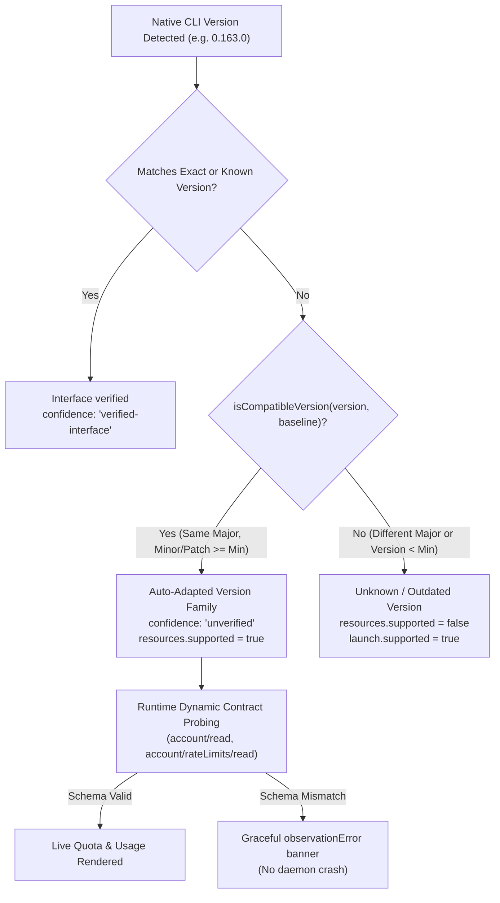

# Provider Version Auto-Adaptation Architecture

## 1. Executive Summary

Principal integrates with external native AI developer tools (Codex CLI, Antigravity / `agy`, GitHub Copilot CLI, and Claude Code). In previous versions, Principal enforced a rigid, patch-level version lock via `compatiblePatch(version, baseline)`:

```ts
actual[0] === minimum[0] && actual[1] === minimum[1] && actual[2] >= minimum[2]
```

When upstream providers issued routine minor releases (e.g. Codex bumping from `0.162.1` to `0.163.0` or Antigravity updating to `1.4.0`), this check immediately failed closed. As a result, users experienced locked-out screens and error banners such as:

```text
Usage unavailable · Requires verified 0.162.1; installed 0.163.0
```

The **Version Auto-Adaptation System** introduces forward-compatible semantic version analysis paired with dynamic runtime response schema validation, allowing Principal to automatically adapt to minor and patch upgrades while still protecting against breaking major-version API shifts.

---

## 2. Architecture & Design Principles

### 2.1 Major Version Family Compatibility (`isCompatibleVersion`)

Following Semantic Versioning (SemVer) principles:
1. **Major Version Boundary (`x.0.0`)**: Represents potential breaking protocol or serialization changes. When a major version bump occurs (e.g. `999.0.0` or `1.0.0` vs baseline `0.162.1`), Principal treats the version as an unverified/unknown version, safely preserving basic launch capabilities while disabling unverified deep observations.
2. **Minor & Patch Forward Compatibility (`x.y.z` where `y >= y_min` or `z >= z_min`)**: Feature additions and bug fixes within the same major version family (including `0.x` pre-1.0 series) are recognized as forward-compatible. Principal auto-adapts without requiring manual version bumps or codebase edits.



### 2.2 Dynamic Runtime Contract Probing

Static version numbers alone do not guarantee API stability. Instead of relying on rigid string matching, Principal validates the native response contracts dynamically at runtime:

- **Codex CLI (`app-server`)**:
  - Connects to `codex app-server --listen stdio://` via JSON-RPC.
  - Sends `initialize` followed by `account/read` and `account/rateLimits/read`.
  - Dynamically inspects response fields: `primary`, `secondary`, `windowDurationMins`, `usedPercent`, `resetsAt`, and `account.planType`.
  - Throws typed `CodexRpcError` if the response contract does not conform, rendering a graceful warning rather than crashing.
- **Antigravity (`agy`)**:
  - Utilizes native statusline hook callbacks and session event observers.
  - Quota and model metrics are parsed on each callback independently of the CLI version.
- **GitHub Copilot CLI (`copilot`)**:
  - Validates `remainingPercentage`, `entitlementRequests`, `usedRequests`, and `resetDate` dynamically.

---

## 3. Provider Baselines

| Provider | Baseline Version | Auto-Adaptation Scope | Verification Mechanism |
| :--- | :--- | :--- | :--- |
| **Codex** | `0.162.1` | `0.162.x` through `0.x.y` | JSON-RPC `app-server` (`account/rateLimits/read`) |
| **Antigravity** | `1.3.3` | `1.3.x` through `1.x.y` | Native statusline callbacks & `--conversation` probe |
| **GitHub Copilot** | `1.0.89` | `1.0.x` through `1.x.y` | Headless CLI `account.getQuota` |
| **Claude Code** | `2.1.281` | `2.1.x` through `2.x.y` | CLI flag probe & observer process |

---

## 4. Implementation Details

### `src/management/compatibility.ts`
- **`parseSemVer(value)`**: Robust regex extracting `[major, minor, patch]` while handling CLI output prefixes (e.g. `codex-cli 0.163.0`) and pre-release tags (`-beta`, `-nightly`).
- **`compareSemVer(a, b)`**: Standard 3-component semantic comparison.
- **`isCompatibleVersion(version, baseline)`**: Evaluates whether `version` belongs to the same major version family and meets or exceeds `baseline`.
- **`compatiblePatch(version, baseline)`**: Preserved for conservative raw disk database and history cloning assertions; now explicitly validates both `0.162.x` and `0.163.x` patch families.

### `src/management/providers.ts`
- `knownVersion`: Officially recognizes `codex` `0.162.1` and `0.163.0` as verified interfaces, elevating installed `0.163.0` to `confidence: 'verified-interface'`.
- Uses `isCompatibleVersion(version, definition.version)` to determine `verifiedVersion` for unverified future versions (e.g. `0.164.x`).
- Sets `capabilities.resources.supported = true` for all compatible versions.
- Updates `versionReason` to:
  `Compatible version family ${version} (baseline ${definition.version}); native response contracts are checked at runtime, live compatibility remains unverified`
- Marks confidence as `'unverified'` for auto-adapted unverified future versions to maintain complete audit transparency.

### `src/management/history-copy.ts` & `src/management/service.ts`
- Native history hydration and exact conversation copying now fully support both `0.162.x` and `0.163.x` patch families while preserving byte-for-byte serialization integrity.

---

## 5. Verification & Test Coverage

The implementation is verified by the automated test suite across all 210 tests:
- `tests/management-health.test.mjs`: Tests `isCompatibleVersion` forward compatibility on `0.164.0`, verified interface status on `0.163.0`, conservative rejection on `0.162.0`, and cross-major rejection on `1.0.0` (for `0.x` baseline).
- `tests/management-integration.test.mjs`: Tests unknown major version isolation (`codex-cli 999.0.0`) confirming that deep observations fail closed while native launch remains available.
- `tests/history-copy.test.mjs`: Confirms native conversation copying and hydration succeed on `0.163.0` and fail closed on unverified versions (`0.170.0`).
