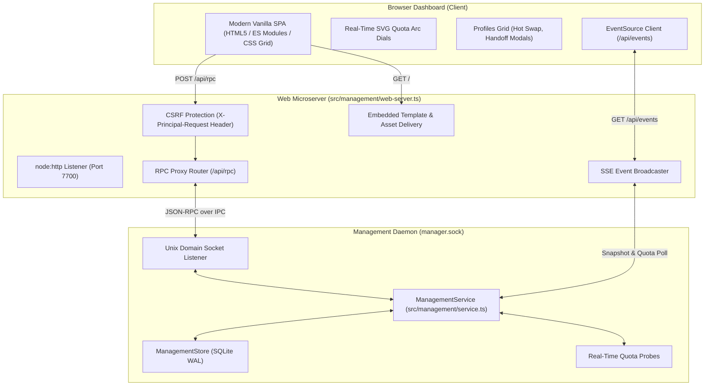

# Principal Web Management Dashboard Architecture

## 1. Overview & Vision
The Principal Web Management Dashboard (`principal web`, `principal ui`, or `principal dashboard`) provides an intuitive, high-performance, browser-based management console for AI coding agent orchestration, account switching, and quota monitoring.

It is designed to give developers who prefer a visual interface a zero-friction experience:
- **Zero External Dependencies**: Powered entirely by Node.js 24+'s built-in `node:http` microserver and native browser Web APIs. Zero bundling tools, zero React-DOM bloat, and zero compilation overhead.
- **Real-Time Synchronized State**: Powered by Server-Sent Events (SSE) at `/api/events`, guaranteeing that terminal activities, agent launches, and background quota observations update the browser in real-time.
- **Focused Profile Operations**: Emphasizes the 5 core actions: **Add Account**, **Share Handoff**, **Import Handoff**, **Rename**, and **Remove/Purge**.
- **Visual Quota Intelligence**: High-resolution SVG arc dials with reset countdowns and smart headroom recommendations.
- **Remote & Mobile Accessible**: Supports local loopback (`127.0.0.1:7700`) as well as local network/Tailscale access (`--host 0.0.0.0` or `--tailscale`).

---

## 2. System Architecture



---

## 3. Security & Access Control Model

### A. CSRF Prevention
Browsers allow cross-origin `POST` requests unless guarded. The Principal Web Server enforces:
- All mutating RPC requests (`POST /api/rpc`) **MUST** include the custom header `X-Principal-Request: 1`.
- Any request without this header is rejected with `403 Forbidden`. Browsers cannot attach custom headers in standard HTML cross-origin form submissions or image tags, making cross-origin attacks impossible.

### B. Binding Boundaries
- By default, the server binds to `127.0.0.1` (loopback only).
- When bound to a network interface (e.g. via `--host 0.0.0.0` or `--tailscale`), Tailscale network access controls or firewall rules apply.

---

## 4. API Specification

| Endpoint | Method | Headers / Params | Description |
|---|---|---|---|
| `/` | `GET` | None | Serves the single-page dashboard HTML application. |
| `/api/health` | `GET` | None | Returns `{ status: 'ok', version: '0.1.5' }`. |
| `/api/snapshot` | `GET` | None | Returns complete system snapshot (profiles, active profiles, tools). |
| `/api/doctor` | `GET` | None | Runs system diagnostics and returns detected AI agents and paths. |
| `/api/events` | `GET` | `Accept: text/event-stream` | Real-time SSE stream pushing live snapshot and quota updates. |
| `/api/rpc` | `POST` | `X-Principal-Request: 1` | Proxies JSON-RPC `{ method, params }` to `ManagementService`. |

---

## 5. CLI Usage

```bash
# Launch dashboard in default browser (Zen / Chrome / Firefox)
principal web

# Start on custom port
principal web --port 8080

# Make accessible over Tailscale for mobile / tablet management
principal web --tailscale

# Run in headless mode without opening a browser window
principal web --no-open
```
